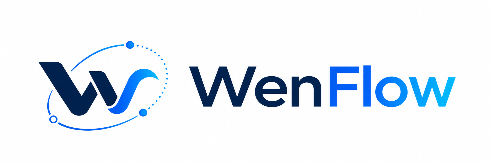
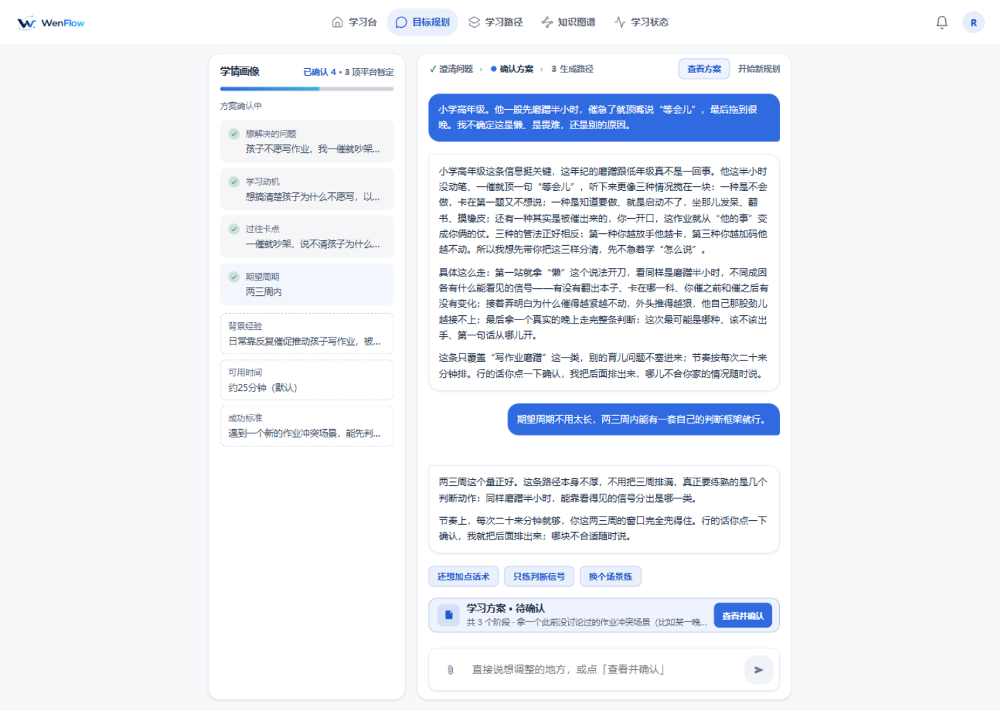
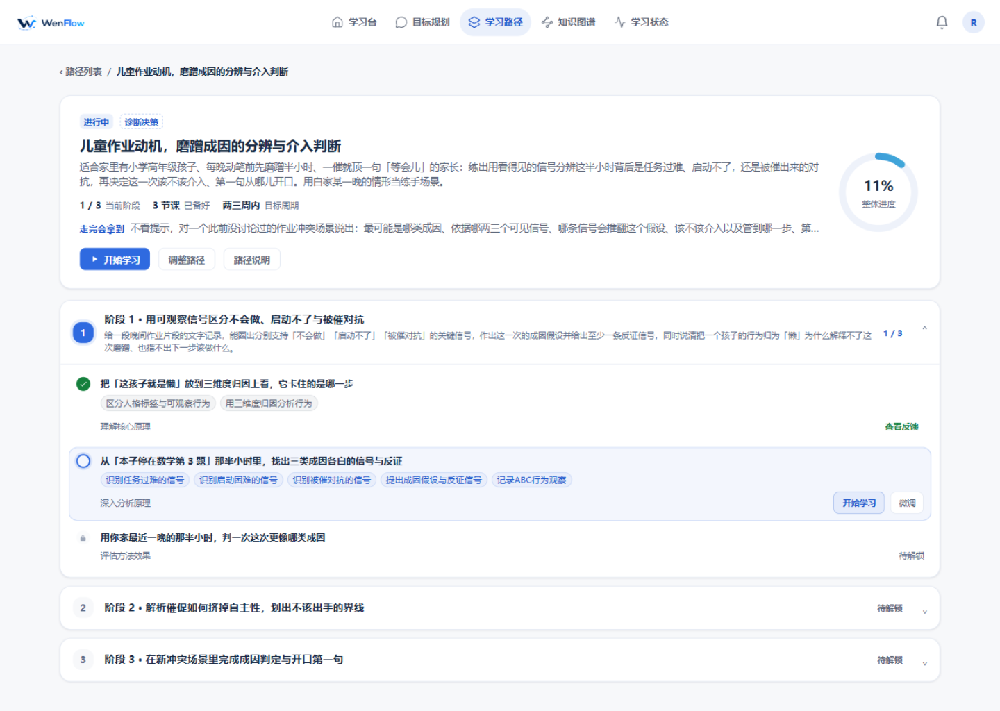
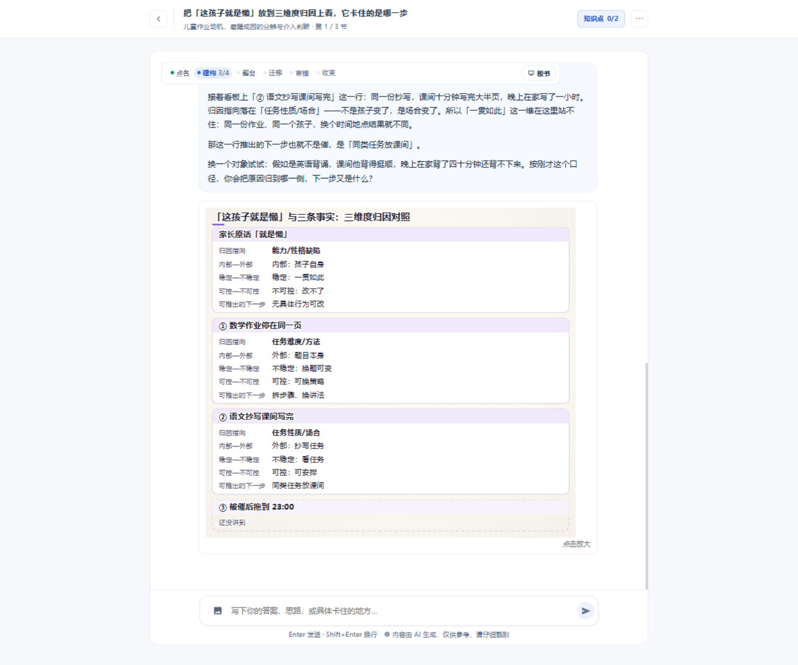
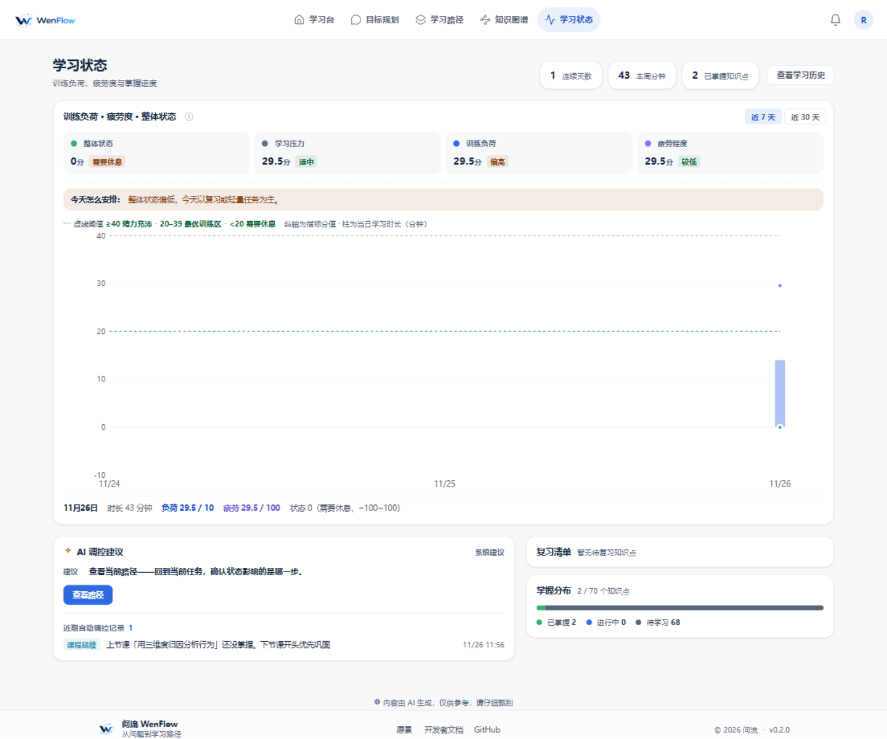
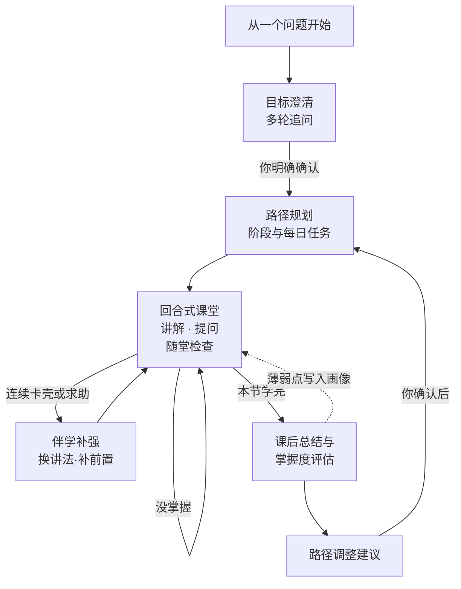

<div align="center">



**先说清你想解决的事，再开始学习。**

**问流 WenFlow** 是开源、可自托管的 AI 原生学习平台：先把模糊的目标聊清楚，再生成学习路径，
用带白板的回合制课堂带你学，并按遗忘曲线安排复习、按训练负荷管住节奏。

[](https://wenflow.org)
[](LICENSE)
[](https://github.com/wenflow-org/wenflow/actions/workflows/quality-check.yml)

[English](README_EN.md) · 中文 · [快速开始](#快速开始)

</div>

在线体验：[wenflow.org](https://wenflow.org)。Demo 站仅作演示，账号与数据会定期清理，请勿存放重要信息。

## 为什么说是「AI 原生」

很多学习困境不是因为不努力，而是目标太大、资料太多、第一步不清晰。传统学习平台以内容供给为起点，课程、题库和路径都是预先做好的。WenFlow 没有预置课程：澄清目标、规划路径、课堂讲解和课后总结，都由 AI 围绕你的真实问题完成。

## 和直接问 AI 有什么区别？

那直接把问题丢给一个 AI 助手不就行了？答案来得很快，但下面这些事仍然要你自己扛：

| | 直接问通用 AI 助手 | 用 WenFlow |
|---|---|---|
| **定目标** | 得自己想清楚要学什么、学到哪一步 | 多轮追问，把模糊目标聊成可验收的目标，再由你确认 |
| **排计划** | 计划靠自己记、自己推动 | 生成一条分阶段的学习路径，今天该学什么直接摆出来 |
| **上课** | 一问一答，默认不检查你是否真的学会 | 回合制课堂：讲一段、问一段；卡住了换讲法、补前置 |
| **记住你** | 默认不追踪你的学习进度 | 记住薄弱点，下节课接着讲，并按遗忘曲线安排复习 |
| **管节奏** | 不关心你累不累 | 追踪训练负荷与疲劳，冲太猛时提醒减速 |

背后的想法写在[愿景页](https://wenflow.org/vision)。

## 用一个真实目标走一遍

以「每周做 Excel 周报太花时间，想用 Python 自动化」这个目标为例：

|  |  |
|---|---|
|  |  |

- **① 聊清目标**（左上）：先追问再动手——基础、动机、每天能投入多久。7 轮问完，目标收窄成「4 周内跑通第一个可用脚本」。
- **② 生成路径**（右上）：你确认之后才排课——4 个阶段、19 节课，按工作日 40 分钟的节奏排好。
- **③ 带白板的课堂**（左下）：讲到流程、对照、映射这类结构性内容时直接画上白板，随讲随更新；讲一段、问一段，答完即时反馈。
- **④ 学习状态**（右下）：训练负荷与疲劳度的趋势，冲太猛时提醒你减速。

另外：

- **接得住你的资料**：上传要学的课程讲义或书籍，讲到相关处会检索并引用原文段落，而不是整本塞给模型。
- **用自己的 Key**：兼容任意 OpenAI 接口的供应商，学习者也可以在设置里填自己的 API Key。
- **数据在自己手里**：SQLite 文件库，零外部数据库依赖；MIT 协议，可完全自托管。

## 快速开始

只需要一个 OpenAI 兼容接口的 API Key。默认按 [DeepSeek](https://platform.deepseek.com/) 配置，也可以在管理后台换成任意兼容供应商。

### Docker（Linux / macOS）

```bash
git clone https://github.com/wenflow-org/wenflow.git
cd wenflow
./docker-start.sh
```

首次运行会引导补齐 `backend/.env`：填一个 `AI_API_KEY`，其余密钥自动生成。启动后访问 [http://localhost](http://localhost)。

### 本地开发（Windows / Linux / macOS）

前置条件：**Node.js >= 22.23.4**（`node -v` 确认）。

```bash
# 1) 克隆并安装依赖（务必用 npm ci，原因见下方「常见坑」）
git clone https://github.com/wenflow-org/wenflow.git
cd wenflow
npm ci && npm --prefix backend ci && npm --prefix frontend ci

# 2) 配置 backend/.env
#    Windows：交互式向导，JWT_SECRET 与加密密钥自动生成，只需填 AI_API_KEY
npm run env:setup
#    Linux / macOS：向导是 PowerShell 脚本，改为手工配置
#    cp backend/.env.example backend/.env
#    至少填写四项：
#      JWT_SECRET=<至少 32 位随机串>
#      SECRET_ENCRYPTION_CURRENT_KEY_ID=v1
#      SECRET_ENCRYPTION_KEYS=v1:<32 字节 Base64>
#      AI_API_KEY=<真实 key>
#    生成随机值：
#      node -e "console.log(require('crypto').randomBytes(48).toString('base64'))"
#      node -e "console.log('v1:'+require('crypto').randomBytes(32).toString('base64'))"

# 3) 一键启动（双库迁移、同步内置 Prompt，再拉起前后端）
npm run dev
```

启动后：

- 学习端：http://localhost:5173
- 管理后台：http://localhost:5173/admin（用上一步设置的管理员账号登录）
- 后端接口：http://localhost:3001

> 起不来或行为异常时，先跑 `npm run doctor`：只读、秒级，逐项体检 Node / 依赖 / `.env` / 双库 / CORS / 端口并给出修复建议。
> 从 0 部署到可用需要配哪些（必需 / 按需增强 / 访问拓扑三档），见 [`DEPLOYMENT.md`](DEPLOYMENT.md) 的「从 0 到可用：必需与可选配置」。

<details>
<summary><b>新机启动清单（实测：空 AI Key + 无插件密钥）</b></summary>

| 项 | 是否必需 | 实测说明 |
|---|---|---|
| Node.js >= 22.23.4 + npm | 必需 | 版本不足会在 Prisma / Vite 阶段失败 |
| `backend/.env` | 必需 | 缺失时启动脚本退出；Linux/macOS 需按上面第 2 步手工创建 |
| `JWT_SECRET`（≥32 位） | 必需 | 缺失或弱值 fail-fast |
| `SECRET_ENCRYPTION_CURRENT_KEY_ID` + `SECRET_ENCRYPTION_KEYS` | 必需 | `prisma:prepare` 的 `runtime:validate` 会校验；缺了直接退出 |
| `DATABASE_URL` / `SYSTEM_DATABASE_URL` | 必需 | 默认 `file:./dev.db` / `file:../system.db`，SQLite 零外部依赖 |
| `AI_API_URL` / `AI_API_KEY` / `AI_MODEL` | 一键启动必需；后端进程非必需 | 空 key 时后端仍能 `/readyz` = `ready`，但 `aiConfiguration` = `warning`，目标对话 / 路径 / 课堂不可用。Windows `npm run dev` 会在启动前拦截空 key；Linux `start-dev.sh` 不拦截 |
| Embedding / Rerank | 可选 | 空值启动正常；语义检索与重排 fail-open 回退关键词/窗口 |
| 联网 / 决策 / 生图 / MCP 插件 | 可选 | 新库默认 4 个插件 bundle 启用；无密钥时页面显示「缺少密钥」。全部停用后重启仍 `ready`。MCP 自带一个 `file-reader` 本机工具，可在插件页停用或删除 |
| `INIT_ADMIN_PASSWORD` | 开发可选 / 生产必需 | 开发不填用内置默认密码；生产留空则跳过创建 |

**只想先看界面、暂时没有 AI Key**：Windows 的 `npm run dev` 会拦截空 `AI_API_KEY`，可绕过一键脚本分步启动：

```bash
npm --prefix backend run prisma:prepare
npm --prefix backend run dev:server   # 3001
npm --prefix frontend run dev         # 5173
```

此时后端仍可登录后台、打开插件配置页与各项只读页面；`/readyz` 保留 `aiConfiguration=warning`，所有 AI 调用不可用。

</details>

<details>
<summary><b>首次使用与常见坑</b></summary>

- **依赖一律用 `npm ci`，不要用 `npm install`。** 本项目 lockfile 里带镜像来源的 optional / peer 条目（如 `@parcel/watcher`、`@bufbuild/protobuf`），`npm install` 会按当前解析结果重写 lockfile 并整批删掉这些行，实测一次就是数百行纯删除，不是代码改动。需要手动装依赖时：`npm ci && npm --prefix backend ci && npm --prefix frontend ci`。
- `npm run dev` 已内置 `prisma:prepare`（生成双 Prisma Client + 双库迁移部署）。只有在手动分步、或显式跳过（PowerShell `./start-dev.ps1 -SkipPrisma`，bash `./start-dev.sh --skip-prisma`）时，才需要自己先跑 `npm --prefix backend run prisma:prepare`。
- 跳过 Prisma 的选项同时会跳过启动前的 core prompts 同步，仅适用于数据库与 prompts 都已就绪的环境。
- Windows 下 `backend/.env` 缺失或 `JWT_SECRET` 不合格时，`start-dev.ps1` 会自动拉起初始化向导；Linux/macOS 的 `start-dev.sh` 不会生成密钥，需按上面第 2 步手工填写。
- **空 AI Key 的边界**：后端进程能启动，但 `npm run dev`（Windows）会在启动前拦下；纯 UI/后台验收按上面的分步命令启动。不要用占位 key 冒充已配置——`sk-your-api-key` 会被当作未配置。
- **端口**：默认占用 3001（后端）与 5173（前端）；被占用时一键启动会退出，先停掉旧进程。
- npm 11.16+ 若在安装时提示 `allow-scripts ... not yet covered`，说明 Prisma / esbuild 等包的安装脚本未执行；按提示运行 `npm approve-scripts --allow-scripts-pending` 后重跑 `npm ci`。本机实测即使跳过这些脚本，Prisma 生成、Vite 开发与前端构建仍可用，但排障时先按提示批准更稳。
- 运行状态探针：`/health`、`/livez` 只表示进程活着，`/readyz` 才代表双库与核心运行态可接收流量。重启后端用统一入口 `node backend/restart.mjs --port=<端口>`（`--status` 查状态、`--stop` 停服务），不要手工杀端口或用裸 `ts-node` 启动。

</details>

## 项目状态

WenFlow 由个人独立研发，自 2026 年 4 月首个版本起持续迭代，目前仍是用于验证教学概念的早期实验项目，接口、数据表结构与提示词协议都可能调整。

功能验证以内置的 AI 虚拟学习者实验室为主，公开演示站 [wenflow.org](https://wenflow.org) 可在线体验完整闭环。

- `main`：稳定分支，默认克隆到这里
- `develop`：主开发分支，最新功能与日常提交在这里

---

## 工程实现

「AI 原生」落到了下面这些工程决定上。从这里往下写给开发者和教育产品同行，每一项只留一句话，细节在对应文档里。

| 主题 | 一句话 | 深入 |
|---|---|---|
| 课堂回合协议 | 讲解、提问、随堂检查按回合推进；连续卡壳时切到「伴学补强」，课后的掌握证据写回学习者画像 | [Agent / Skill 全景](doc/AGENT_SKILL_MANUAL.md) |
| 学习者模型 | 把长期画像、近期状态、路径级记忆（FSRS-6 复习调度）聚合成一份学习者快照，供教学与路径重排消费 | [学习者模型架构](doc/LEARNER_MODEL_ARCHITECTURE.md) |
| 学习负荷模型 | 借鉴耐力训练的负荷 / 疲劳 / 状态思路，按天推进，用相对量判断「还能不能加量」 | [学习者中心与状态融合](doc/LEARNER_CENTER_AND_STATE_FUSION.md) |
| 虚拟学习者实验室 | 用角色卡派生 AI 学习者，像真实用户一样黑盒跑完整学习流程，再由独立裁判给教学打分 | [设计](doc/VIRTUAL_LEARNER_DESIGN.md) · [链路](doc/VIRTUAL_LEARNER_CHAIN.md) |
| 教育理论映射 | 每条教学设计登记理论来源、文献与代码落点 | [教育理论地图](doc/EDUCATIONAL_THEORY_MAP.md) |
| 路径生产与重排 | 路径怎么生成、何时触发重排的契约 | [契约](doc/PATH_PRODUCTION_REPLAN_CONTRACT.md) |
| 提示词与 Skill | File-as-Truth：YAML 真源 → 编译产物 → 数据库镜像，带守门检查与一键回滚 | [Skill 协议 v4](doc/SKILL_PROTOCOL_V4.md) · [开发指南](doc/SKILL_DEVELOPMENT_GUIDE.md) |
| 模型网关 | OpenAI 兼容接入，按 Agent / Skill 路由模型，SSE 流式、重试预算、思考模式 | [网关设计](doc/MODEL_GATEWAY_DESIGN.md) |
| 课堂白板 | 教学图的理论依据与证据分级 | [教学图研究](doc/DIAGRAM_PEDAGOGY_RESEARCH.md) |

<details>
<summary><b>课堂的一个回合是怎么跑的</b></summary>

每一节课按回合推进：讲解 → 提问 → 随堂检查。



- **不会自作主张**：生成路径、调整计划都要经过学习者的明确确认，系统不会偷偷改路线。
- **卡壳有兜底**：连续答错或明确求助时，课堂会切进「伴学补强」，先补齐前置概念再往下走，而不是硬念下一段。
- **跨课有记忆**：每节课的掌握情况会沉淀进学习画像，下一节课从上次的薄弱点自然接上，并按记忆规律安排复习。
- **讲解不刷屏**：限制单轮知识量与篇幅，长对话自动压缩。

</details>

<details>
<summary><b>学习负荷的四个读数</b></summary>

很多人学三天就放弃，不是懒，是开头冲太猛。WenFlow 借鉴耐力训练里「负荷 / 疲劳 / 状态」的思路，给学习强度也装了一块仪表盘：

| 界面上的读数 | 缩写 | 它在告诉你什么 |
|---|---|---|
| **学习压力** | LSS | 这一节课学得有多猛：由认知负荷、效率、时长、完成率与任务类型综合算出 |
| **训练负荷** | KTL | 长期学习压力的累积：变化平缓，反映近期的底子 |
| **疲劳程度** | LF | 近期学习压力的累积：变化快，连着学几天就会上去 |
| **整体状态** | LSB | 综合读数：现在处于精力充沛、最优训练区还是该休息；刚起步、数据不足时显示「积累中」 |

四个读数刻度不同，产品里只看趋势、不横向比数值。判定用的是相对量（疲劳相对底子涨了多快），所以习惯每天多学几节课的人不会被误判成「过度疲劳」。

这是一套工程启发式口径，不是医学或运动科学上的测量。实现见 `backend/src/services/learning/learning-load.pmc.ts` 与 `learning-load-verdict.ts`。

</details>

<details>
<summary><b>虚拟学习者实验室怎么工作</b></summary>

没有大规模真人样本时，怎么知道教学有没有效？项目内置 Virtual Learner Lab，让 AI 来当学生：

- **AI 扮演学习者**：从角色卡派生出有基础、有性格、有时间预算的虚拟学习者，像真实用户一样走完「澄清目标 → 生成路径 → 上课答题」。
- **黑盒模拟**：只用产品界面能看到的动作，不改数据、不读内部状态；另有辅助模拟，由人选定故事与目标后跑完整链路。
- **独立裁判**：教学结束后，由不参与教学的裁判与角色保真审计给教学质量打分。
- **角色卡库**：仓库自带覆盖学科、工程实操、应试、业务诊断等场景的角色卡；卡只是档案，派生学习者时才创建账号。

需要知道的局限：虚拟学习者自带偏置，而它目前是主要的评测语料，偏置可能被误读成产品特性。已知偏差在[设计文档](doc/VIRTUAL_LEARNER_DESIGN.md)第 11 节逐条量化。

</details>

<details>
<summary><b>管理后台</b></summary>

学习端之外还有一套运营与可观测后台（`/admin`），数据全部来自真实 API：

- **Prompt 设计台（File-as-Truth）**：在线编辑提示词、编译守门、发布与一键回滚；本地 YAML 源码与数据库运行镜像自动同步。
- **全链路可观测**：每次调用的 Token 成本、模型耗时、Agent 执行链路与重试时间线。
- **模型路由**：兼容所有 OpenAI 接口的供应商，可按 Agent / Skill 分配快模型或推理模型，也支持用户自带 API Key；配置优先级为环境变量 → 平台默认 → Agent / Skill 级 → 用户自定义。
- **运营工作台**：教学会话、学习状态风险、复习积压、反馈与公告。

</details>

## 技术栈

| 层级 | 技术 |
|------|------|
| **前端** | Vue 3 + TypeScript + Vite + Pinia |
| **后端** | Node.js + Express + TypeScript + Prisma |
| **数据库** | SQLite 双库架构（业务库 + system 库），零外部数据库依赖即可跑通 |
| **AI 接入** | OpenAI 兼容网关，支持 SSE 流式、重试预算与 thinking mode 控制；Embedding / Rerank 可选，未配置时 fail-open 回退关键词检索 |
| **Agent / Skill** | 5 个顶层 Agent（目标 / 路径 / 教学 / 画像 / 仿真）+ Skill 执行层 + 流程编排器 + 持久化事件链 |
| **安全** | JWT + CSRF + 登录限流 + Secret AES-256-GCM 静态加密 + 敏感存储权限审计 |
| **部署** | Docker（Nginx + 后端，只发布 Nginx 端口）或本地 `npm run dev` |

<details>
<summary><b>项目结构</b></summary>

```text
backend/            Node.js + Express + TypeScript 后端
  src/
    agents/         顶层 Agent（含 learner-model-agent / simulation-agent）
    skills/         Skill 实现（提示词真源在 prompts/，不在此处硬编码）
    coordinators/   业务流程编排（目标 / 路径 / 教学 / 学习者 / 仿真）
    gateway/        OpenAI 兼容模型网关
    routes/         HTTP 路由（用户端 / 管理端）
    services/       领域服务与数据访问
    virtual-lab/    虚拟学习者实验室
    events/         持久化事件与 outbox
    scripts/        正式工具：门禁 / 只读审计 / 探针 / 回填 / 运维
  prisma/           主库 schema 与 migrations；system/ 为 System DB
frontend/           Vue 3 + TypeScript + Vite 前端
  src/
    views/v2/             学习者端页面
    views/admin-redesign/ 管理端页面与场景清单 manifest.ts
    components/mk/        管理端共享原语（MkKpi / MkRowList / MkDistBand …）
    api/ · stores/ · router/ · composables/
prompts/            File-as-Truth 提示词：core/*.yaml 真源 → skill.*.md 编译产物
scripts/            仓库根脚本（跑批 / 巡检 / 演示 / 门禁），索引见 doc/DEV_SCRIPTS.md
virtual-learners/   虚拟学习者语料：presets.yaml + 学习者卡库 cards/
doc/                设计文档总索引 doc/README.md（过程材料在 gitignored 的 doc/local/）
.github/workflows/  CI 门禁 quality-check.yml
```

</details>

<details>
<summary><b>页面地图：学习者端</b></summary>

落地页 `/` 与 `/vision`，登录 `/login`、注册 `/register`，登录后进入学习台。

顶栏 / 底栏五个入口：

| 页面 | 路径 | 说明 |
|------|------|------|
| 学习台 | `/dashboard` | 今日行动、路径进度、连续学习天数 |
| 目标规划 | `/goal-conversation` | 多轮对话澄清真实目标 |
| 学习路径 | `/learning-paths` | 路径列表与进度 |
| 知识图谱 | `/knowledge-map` | 全部路径的知识聚合视图（学习页内只看当前路径） |
| 学习状态 | `/learning-state` | 训练负荷、疲劳度与掌握进度 |

核心学习流：注册 / 登录 → `/onboarding` 引导 → `/goal-conversation` 澄清目标 → 你确认后生成路径 → `/learning-paths` → `/learning-path/:id` 路径详情 → `/learn/:taskId` 回合式学习 → `/learn/:taskId/evaluation/:sessionId` 课后评估。

个人中心在 `/user/*`：账户、设置（含 API 接入）、调用日志、成就、学习历史，页内还可进「资料库」（`/library`，上传学某课 / 学某书的资料供课堂引用）。

</details>

<details>
<summary><b>页面地图：管理端</b></summary>

管理后台在 `/admin`，侧栏分五组，另有一个置顶的平台总览：

- **运营**：运营中心（待办、反馈、成就、公告、站内通知）、系统设置（模型与接入、数据导出、会话安全、访问与注册）、用户账号
- **学习**：目标对话、学习路径、教学会话、学习状态、复习积压
- **仿真**：虚拟学习者、会话评审报告、学习者卡库
- **Skill**：字段流转、Skill 目录、插件
- **观测与排查**：执行日志、审计日志、成本分析、健康中心

页面清单以 [`frontend/src/views/admin-redesign/manifest.ts`](frontend/src/views/admin-redesign/manifest.ts) 为准；页面新增、下线与旧链接重定向的历史见 [`CHANGELOG.md`](CHANGELOG.md)。

</details>

## 运维与进阶

<details>
<summary><b>局域网多设备调试（手机 / 平板真机）</b></summary>

```bash
npm run dev:lan                     # 自动获取局域网 IP
./start-lan.ps1 -LanIP 192.168.31.26  # 或手动指定
```

会把局域网 IP 加入 `CORS_ORIGIN`，适合多设备调试前台页面；不改变管理员登录的 `ADMIN_ACCESS_MODE` 限制。

</details>

<details>
<summary><b>本机 Nginx 测试部署（HTTP）</b></summary>

```bash
npm run dev:nginx                        # 依赖本机已装 nginx 且在 PATH
./start-dev.ps1 -UseNginx -Domain test.example.com
./start-dev.ps1 -UseNginx -NginxExePath "C:\nginx\nginx.exe"
```

会自动构建前端并生成配置到 `runtime/nginx/wenflow.nginx.conf`，启动前校验 80 端口可用。

</details>

<details>
<summary><b>Docker 部署（Linux / macOS）</b></summary>

```bash
./docker-start.sh          # 交互式补齐 backend/.env 后启动
docker compose -f docker-compose.operations.yml run --rm backup   # 数据库备份（需先设 WENFLOW_BACKUP_HOST_DIR）
```

`docker-compose.yml` 提供 migrate / backend / nginx 三个服务，默认只发布 Nginx（80），不发布后端 3001；后端强制 `ADMIN_ACCESS_MODE=private`。详见 [`DEPLOYMENT.md`](DEPLOYMENT.md)。

</details>

<details>
<summary><b>质量门禁（与 CI 一致）</b></summary>

`npm run check` 串起三个阶段，与 CI 的三个并行 job 一一对应：

```bash
npm run check:quality   # secret 扫描 → Prisma 双 schema 校验 → 空库迁移回放 → 前后端 typecheck →
                        # LLM 调用契约 → 常量来源 → 双库迁移部署 → prompts 门禁 → 设计系统守卫 →
                        # 路由-数据边界 → 启动入口守卫 → doc 死链 → lint
npm run check:test      # 后端 + 前端测试（含覆盖率）
npm run check:build     # 后端 + 前端构建
npm run check           # 三者依次全跑（等价于 CI）
```

CI（`.github/workflows/quality-check.yml`）在 push main/master/develop 与 PR 时执行；失败可用 `npm run ci:status` 回看最近 run 的失败 job / 步骤 / 错误行。

</details>

<details>
<summary><b>Prompt 初始化与维护（File-as-Truth）</b></summary>

真源是 `prompts/core/*.yaml`（唯一人工编辑入口，进 git），编译产物是 `prompts/skill.*.md`（模型唯一读取文本），数据库 `agent_prompts` 只是运行时镜像。编辑 → 编译 → 发布链路（含守门检查与回滚）在管理端「Prompt 设计台」操作，机制见 [`doc/SKILL_PROTOCOL_V4.md`](doc/SKILL_PROTOCOL_V4.md)，目录说明见 [`prompts/_README.md`](prompts/_README.md)。

```bash
cd backend
npm run prompts:compile-all    # core/*.yaml → skill.*.md（不写库）
npm run prompts:sync-core      # 同步数据库 ACTIVE 版本（启动时也会自动执行）
npm run prompts:backfill-core  # 升级后只补新增节点，不覆盖已有 ACTIVE 配置
npm run prompts:lint && npm run prompts:core:check
```

</details>

<details>
<summary><b>数据与存储</b></summary>

两个 SQLite 库，相对 URL 按各自 schema 目录解析：

| 库 | Schema | 环境变量 | 默认路径 |
|----|--------|----------|----------|
| 主库 | `backend/prisma/schema.prisma` | `DATABASE_URL` | `file:./dev.db` |
| System DB | `backend/prisma/system/schema.prisma` | `SYSTEM_DATABASE_URL` | `file:../system.db` |

- 迁移与校验：`npm run prisma:migrate:verify-clean`（空库回放）、`npm run prisma:baseline:audit`（只读审计）、`npm --prefix backend run prisma:migrate:deploy:all`
- 备份与维护：`npm run database:backup:create` / `database:backup:verify` / `database:vacuum:status` / `database:vacuum`
- **换 worktree 或移动目录后连错库**：Prisma 客户端会把生成时的相对路径写进 `node_modules/.prisma/client/index.js`，应用可能仍解析到另一棵树的库，表现为“迁移与运行数据分离”。修复方式是**在当前工作区**重新生成客户端并部署迁移：`npm --prefix backend run prisma:prepare`。
- 不要继续使用旧的 `file:./prisma/*.db`，也不要把 System URL 改成 `file:./system.db`。

</details>

<details>
<summary><b>前端 API 环境变量</b></summary>

- 默认前端通过相对路径 `/api` 访问后端，由 Vite 代理或 Nginx 转发；无特殊部署需求保持默认即可。
- 配置只认 `VITE_API_BASE_URL`（`frontend/.env`）；开发模式固定走 `/api` 代理，缺省值也是 `/api`。

</details>

<details>
<summary><b>管理员账户与反向代理</b></summary>

首次启动时按 `backend/.env` 自动创建初始管理员（`INIT_ADMIN_NAME` / `INIT_ADMIN_PASSWORD`，已有管理员则跳过）。首次登录后请立即修改密码。

管理员登录默认 `ADMIN_ACCESS_MODE=private`（仅本机与局域网），可设 `loopback`（仅本机）或 `any`，并用 `ADMIN_ALLOWED_IPS` 精确放行；该策略可在管理端「模型与接入」页热生效。确有公网远程管理需求时，请配合 VPN 或精确 IP 白名单。详见 [`doc/ADMIN_OPERATIONS_MANUAL.md`](doc/ADMIN_OPERATIONS_MANUAL.md)。

反向代理注意：

- `CORS_ORIGIN` 不要写尾部 `/`（`https://demo.example.com` 而不是 `https://demo.example.com/`）
- `TRUST_PROXY` 填直连后端的代理 IP/CIDR，生产禁止用 `true`
- 不要暴露可绕过代理直连的后端端口（Docker 默认只发布 Nginx）
- 遇到“请求来源不被允许”时，先比对浏览器 `Origin` 与 `CORS_ORIGIN`

</details>

<details>
<summary><b>常用命令索引</b></summary>

完整明文见根 `package.json` 与 [`doc/DEV_SCRIPTS.md`](doc/DEV_SCRIPTS.md)（三个脚本目录的定位、跑批链路与工具索引）：

| 分类 | 命令 | 说明 |
|------|------|------|
| 启动 | `npm run dev` / `dev:win` / `dev:unix` | 跨平台 / Windows / Linux·macOS |
| 启动 | `npm run dev:lan` / `dev:nginx` | 局域网调试 / 本机 Nginx 测试部署 |
| 后端重启 | `node backend/restart.mjs --port=3011` | 统一入口：类型快检 → 停旧进程 → 起进程 → 等 `/readyz`；`--status` 查状态、`--stop` 停服务 |
| 自诊 | `npm run doctor` | 只读体检；`-- --deep` 追加 prompts 对账 |
| 门禁 | `npm run check` | `check:quality` + `check:test` + `check:build` |
| 测试 | `npm run test` / `test:coverage` | 后端 Jest（CI 用 `--runInBand`）/ 覆盖率 |
| 安全 | `npm run security:scan` / `permissions:audit` / `secrets:audit` | 密钥扫描 / 权限审计 / Secret 迁移审计（对应的 `*:repair`、`*:migrate` 才写库） |
| 运维 | `npm run ci:status` | 回看最近 CI run 的失败 job / 步骤 / 错误行 |

</details>

## 文档

- 文档总索引：[`doc/README.md`](doc/README.md)（按「活规范 / 设计留痕 / 历史快照」分类）
- 部署 / 安全 / 运营：[`DEPLOYMENT.md`](DEPLOYMENT.md) · [`SECURITY.md`](SECURITY.md) · [`doc/ADMIN_OPERATIONS_MANUAL.md`](doc/ADMIN_OPERATIONS_MANUAL.md)
- 开发脚本：[`doc/DEV_SCRIPTS.md`](doc/DEV_SCRIPTS.md)
- 更新日志：[`CHANGELOG.md`](CHANGELOG.md)
- 参与开发：[`CONTRIBUTING.md`](CONTRIBUTING.md)（分支模型、门禁、提交规范与共享工作树纪律）

## License

本项目采用 [MIT License](LICENSE) 开源协议。

Copyright (c) 2026 wenflow-org

## 致谢

感谢 [Linux.do](https://linux.do/) 社区成员长期以来的支持与分享。

---

*当 AI 能够解答一切标准问题时，提出好问题的个体将定义未来。*
