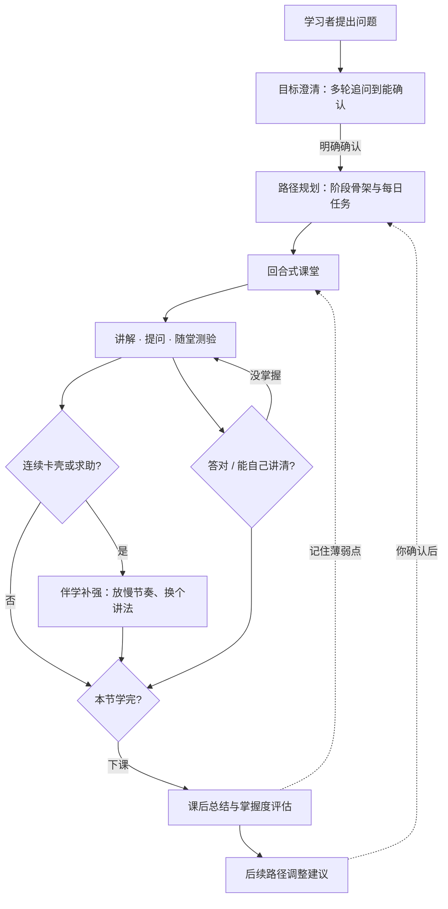

# WenFlow


> ⚠️ **当前主要开发版本**: [develop](https://github.com/wenflow-org/wenflow/tree/develop) 分支 | main 分支为稳定版

**一款从真实问题出发的 AI 学习支持服务平台**

> 核心理念：学习始于对真实问题的澄清，而非对课程的选择。

[English Version](README_EN.md) | 中文版

🌐 **Demo 站点**: https://wenflow.org

> 仅作 Demo 演示，不提供正式服务，会定期清理账号与数据，请勿用于存放重要信息。

[](LICENSE)
[](https://nodejs.org)
[](https://vuejs.org)

📋 **[更新日志](CHANGELOG.md)** · 按月记录主要功能更新

---

## 为什么存在？

许多学习困境并非源于努力不足，而是目标过于宏大、资料过载、第一步不够清晰。

传统学习产品大多以“内容供给”为起点：课程、资料、题库与预设路径。WenFlow 则从另一端切入——先帮助学习者澄清真正要解决的问题，再由此生成可执行的学习路径，并通过对话、输出与反馈持续调整。

在 AI 能够快速生成大量答案的背景下，更值得训练的能力不再局限于内容记忆，而是：

- **问题定义**：将模糊目标转化为可探索的问题
- **系统思维**：理解知识、场景与行动之间的结构关系
- **判断力**：在信息过载中辨别值得采信的内容
- **AI 协作**：将 AI 作为追问、反馈与推演的伙伴
- **创造力**：在既有知识之间建立新的联结

**答案将日益廉价，问题本身将愈发重要。**

---

## 核心体验预览

这 6 张图按“从真实问题出发，到进入完整学习闭环”的顺序展示 WenFlow 的核心体验。

| ① 从一个问题开始 |
|:---:|
|  |
| 学习者先陈述问题，而非直接选课 |

| ② 澄清真实目标 | ③ 生成学习路径 |
|:---:|:---:|
|  |  |
| AI 通过多轮追问澄清真实目标 | 将模糊目标拆解为阶段、任务与可立即执行的第一步 |

| ④ 进入回合式学习 | ⑤ 学习闭环总览 |
|:---:|:---:|
|  |  |
| AI 讲解、学习者作答并即时获得反馈，教学过程动态调整 | 课后生成总结与评估，并给出后续学习建议 |

| ⑥ 学习状态追踪 |
|:---:|
|  |
| LSS / KTL / LF / LSB 持续追踪学习状态，并在疲劳时予以提醒 |

---

## 核心亮点

### 1. 真正在“上课”的多 Agent 课堂

多数 AI 教学工具本质是一个套了提示词的聊天框，聊着聊着就跑偏。WenFlow 背后是一套明确的分工与回合协议：



- **不会自作主张**：生成路径、调整计划都要经过学习者的明确确认，系统不会偷偷改你的路线。
- **卡壳有兜底**：连续答错或明确求助时，课堂会切进“伴学补强”，先补齐前置概念再往下走，而不是硬念下一段。
- **跨课有记忆**：每节课的掌握情况会沉淀进学习画像，下一节课从你上次的薄弱点自然接上，并按记忆规律安排复习。
- **白板随讲随画**：老师讲到结构性内容时，课堂白板会同步上墙图示（脚本行↔手工动作映射、流程回路、对照表等），把纯文字造成的认知压力搬到板上；学生盯着的板随教学推进更新，可放大细看。

### 2. 像管理体能一样管理脑力负荷

很多人学三天就放弃，不是因为懒，而是开始时冲太猛。WenFlow 借鉴耐力运动科学的负荷与恢复模型，给学习强度也装上“仪表盘”：

| 指标 | 全称 | 用大白话讲 |
|------|------|------|
| **LSS** | 学习压力评分 | 今天这一顿学得有多猛：由任务难度、时长、认知负荷与完成率综合算出 |
| **KTL** | 知识训练负荷 | 你的长期底子：累计学习量按日衰减保留（半衰期约 13.5 天） |
| **LF** | 学习疲劳度 | 最近累不累：短期累计疲劳（半衰期约 1.9 天），连轴转就会飙升 |
| **LSB** | 学习状态平衡 | 还能不能继续加量：KTL − LF，偏低时提示过度学习，建议休息或复习 |

### 3. 把教育学理论落进代码

WenFlow 的教学行为不是提示词拍脑袋，每条设计都有对应的理论来源（11 条与产品行为直接对应，完整 16 条含文献链接见 [`doc/EDUCATIONAL_THEORY_MAP.md`](doc/EDUCATIONAL_THEORY_MAP.md)）：

- **认知负荷理论**：限制单轮知识量与篇幅，长对话自动压缩，拒绝刷屏式讲解
- **最近发展区 + 支架**：难度随理解度自动升降，受阻时回补前置基础
- **费曼技巧 + 检索练习**：能独立讲清、并通过随堂检查才算掌握，相信自己“看懂了”不算数
- **有效失败**：先独立试错，再由 AI 带着对比复盘，把答错变成理解的切口
- **间隔效应与复习闭环**：按 FSRS-6 记忆模型安排跨天复习（替代早期 SM-2 式固定倍增），学完的知识有安排、不是一次性消耗

### 4. 虚拟学习者实验室

为了在没有大规模真人样本时也能验证教学效果，项目内置 Virtual Learner Lab：内置 200 张默认金标角色卡（不同基础与性格的**纯档案**，首次启动自动载入卡库），从卡库派生学习者后才创建对应账号；虚拟学习者以真实用户的方式完整跑完“澄清目标 → 生成路径 → 上课答题”，再由独立的裁判与角色保真审计给教学质量打分。

- **黑盒模拟**：只用产品界面能看到的动作，不改数据、不读内部状态
- **Quick Learn**：挑一个任务自动上完一节课并生成报告，用于快速回归

### 5. 自带 18 个场景页的管理后台

学习端之外还有一套完整的运营与可观测后台（`/admin`），数据全部来自真实 API：

- **Prompt 设计台（File-as-Truth）**：在线编辑提示词、编译守门、发布与一键回滚，本地 YAML 源码与数据库运行镜像自动同步
- **全链路可观测**：每次调用的 Token 成本、模型耗时、Agent 执行链路与重试时间线
- **模型路由**：兼容所有 OpenAI 接口的供应商，默认 `deepseek-v4.1-flash`，可按 Agent 分配快模型或推理模型，也支持用户自带 API Key

---

## 3 分钟快速开始

前置条件：**Node.js >= 22.23.4**；Windows（PowerShell 5.1+）、Linux、macOS 均可；Linux/macOS 也可直接 `./docker-start.sh` 走 Docker。

```bash
# 1) 克隆
git clone https://github.com/wenflow-org/wenflow.git
cd wenflow

# 2) 初始化配置（按提示填 AI 接口 Key 与管理员密码）
npm run env:setup

# 3) 一键启动（自动安装依赖、初始化双库、同步内置 Prompt，再拉起前后端）
npm run dev
```

启动后：

- 学习端：http://localhost:5173
- 管理后台：http://localhost:5173/admin（用第 2 步设置的管理员账号登录）
- 后端接口：http://localhost:3001

> 起不来或行为异常时，先跑 `npm run doctor`：只读、秒级，逐项体检 Node / 依赖 / `.env` / 双库 / CORS / 端口并给出修复建议。
> 从 0 部署到可用需要配哪些（必需 / 按需增强 / 访问拓扑三档），见 [`DEPLOYMENT.md`](DEPLOYMENT.md) 的「从 0 到可用：必需与可选配置」。

<details>
<summary><b>首次使用与常见坑（点开）</b></summary>

- **依赖一律用 `npm ci`，不要用 `npm install`。** 本项目 lockfile 里带镜像来源的 optional / peer 条目（如 `@parcel/watcher`、`@bufbuild/protobuf`），`npm install` 会按当前解析结果重写 lockfile 并整批删掉这些行，实测一次就是数百行纯删除，不是代码改动。需要手动装依赖时：`npm ci && npm --prefix backend ci && npm --prefix frontend ci`。
- `npm run dev` 已内置 `prisma:prepare`（生成双 Prisma Client + 双库迁移部署）。只有在手动分步、或显式跳过（PowerShell `./start-dev.ps1 -SkipPrisma`，bash `./start-dev.sh --skip-prisma`）时，才需要自己先跑 `npm --prefix backend run prisma:prepare`。
- 跳过 Prisma 的选项同时会跳过启动前的 core prompts 同步，仅适用于数据库与 prompts 都已就绪的环境。
- `backend/.env` 缺失或 `JWT_SECRET` 不合格时，启动脚本会自动拉起初始化流程。
- 运行状态探针：`/health`、`/livez` 只表示进程活着，`/readyz` 才代表双库与核心运行态可接收流量。重启后端用统一入口 `node backend/restart.mjs --port=<端口>`（`--status` 查状态、`--stop` 停服务），不要手工杀端口或用裸 `ts-node` 启动。

</details>

---

## 项目状态

WenFlow 由个人独立研发，自 2026 年 4 月首个版本起持续迭代；功能验证以内置的 AI 虚拟学习者实验室为主，公开演示站（[wenflow.org](https://wenflow.org)）可在线体验完整闭环。

项目并非对既有学习流程的简单加速，而是试图验证另一条路径：以真实问题为起点，由 AI 协助澄清目标、生成路径并组织反馈，是否更契合 AI 时代的学习方式。

项目将持续探索 5 类能力的训练方式：**问题定义能力、系统思维、判断力、AI 协作力、创造力**。

---

## 技术栈

| 层级 | 技术 |
|------|------|
| **前端** | Vue 3 + TypeScript + Vite 6 + 自研 Mk* 管理端原语 + lucide 图标 + Pinia |
| **后端** | Node.js + Express + TypeScript + Prisma |
| **数据库** | SQLite 双库架构（主库 54 个模型 + system 库 15 表），零外部数据库依赖即可跑通 |
| **AI 接入** | 四层模型家族：① 对话/推理/评测 LLM——OpenAI 兼容网关（默认均为 deepseek-v4.1-flash），支持 SSE 流式、重试预算与 thinking mode 控制；② 基础设施模型——Embedding / Rerank（默认 bge-m3 / bge-reranker-v2-m3，资料语义检索与重排，未配置时 fail-open 回退关键词）；③ 决策模型（decision-gate，资料质量闸门判定）；④ 生图（text-to-image 外挂）。②③④ 均可选，不配置按 documented 语义降级 |
| **Agent / Skill** | 5 个顶层 Agent（目标 / 路径 / 教学 / 画像 / 仿真）+ Skill 执行层（提示词真源 `prompts/core/*.yaml` → 编译产物 → 数据库镜像）+ 流程编排器 + 持久化事件链 |
| **模型配置分层** | 环境变量 → 平台默认 → Agent / Skill 级 → 用户自定义 API 与模型覆盖 |
| **虚拟实验** | Virtual Learner Lab（黑盒模拟 + Quick Learn） |
| **可观测** | Agent / Skill 调用日志、Trace 瀑布、LLM 执行明细 |
| **安全** | JWT + CSRF + 登录限流 + Secret AES-256-GCM 静态加密 + 敏感存储权限审计 |
| **部署** | 跨平台启动脚本（`npm run dev`）+ 可选 Nginx 测试部署 + Docker（Linux/macOS 推荐） |

<details>
<summary><b>项目结构（点开）</b></summary>

```text
backend/            Node.js + Express + TypeScript 后端
  src/
    agents/         顶层 Agent（含 learner-model-agent / simulation-agent）
    skills/         Skill 实现（提示词真源在 prompts/，不在此处硬编码）
    coordinators/   业务流程编排（目标 / 路径 / 教学 / 学习者 / 仿真）
    gateway/        OpenAI 兼容模型网关
    routes/         HTTP 路由（用户端 / 管理端）
    services/       领域服务与数据访问
    virtual-lab/    虚拟学习者实验室
    events/         持久化事件与 outbox
    scripts/        正式工具：门禁 / 只读审计 / 探针 / 回填 / 运维
  prisma/           主库 schema 与 migrations；system/ 为 System DB
frontend/           Vue 3 + TypeScript + Vite 6 前端
  src/
    views/v2/             学习者端页面
    views/admin-redesign/ 管理端页面与场景清单 manifest.ts
    components/mk/        管理端共享原语（MkKpi / MkRowList / MkDistBand …）
    api/ · stores/ · router/ · composables/
prompts/            File-as-Truth 提示词：core/*.yaml 真源 → skill.*.md 编译产物
scripts/            仓库根脚本（跑批 / 巡检 / 演示 / 门禁），索引见 doc/DEV_SCRIPTS.md
virtual-learners/   预制虚拟学习者语料 presets.yaml + 学习者卡库金标 cards/（200 张默认金标，首次启动自动种子）
doc/                设计文档总索引 doc/README.md（过程材料在 gitignored 的 doc/local/）
.github/workflows/  CI 门禁 quality-check.yml
```

</details>

---

## 页面地图

<details>
<summary><b>学习者端（点的展开）</b></summary>

落地页 `/` 与 `/vision`，登录 `/login`、注册 `/register`，登录后进入 V2 壳。

顶栏 / 底栏五个入口：

| 页面 | 路径 | 说明 |
|------|------|------|
| 学习台 | `/dashboard` | 今日行动、路径进度、连续学习天数 |
| 目标规划 | `/goal-conversation` | 多轮对话澄清真实目标 |
| 学习路径 | `/learning-paths` | 路径列表与进度 |
| 知识图谱 | `/knowledge-map` | 全部路径的知识聚合视图（学习页内只看当前路径） |
| 学习状态 | `/learning-state` | LSS / KTL / LF / LSB 与疲劳提醒 |

核心学习流：注册 / 登录 → `/onboarding` 引导 → `/goal-conversation` 澄清目标 → 你确认后生成路径 → `/learning-paths` → `/learning-path/:id` 路径详情 → `/learn/:taskId` 回合式学习 → `/learn/:taskId/evaluation/:sessionId` 课后评估。

个人中心在 `/user/*`：账户、设置（含 API 接入）、调用日志、成就、学习历史。旧的 `/v2/*` 地址会自动重定向到正式路径。

</details>

<details>
<summary><b>管理端场景（点的展开）</b></summary>

管理后台在 `/admin`，共 **19 个场景页 / 7 个分组**（另有 1 个隐藏的「运营术语表」，仅供页头帮助入口）：

- **总览**：平台总览，当日系统健康度、失败率最高的模型与待排查事项
- **学习**：目标对话、学习路径、教学会话、学习状态（风险与疲劳度，支持手动重算快照）、复习积压
- **仿真**：虚拟学习者（运行态：并发配额 / 全局限速 / 实例流水 / 批量新建、单步测试）、学习者卡库（纯档案角色卡：结构化导入导出、一键加载 200 金标预置，从卡派生学习者才建账号）
- **Skill**：字段流转（阶段泳道 + 字段数据旅程 / 逻辑图 + 调用用量）、Skill 目录（Skill 运行 + 模型路由；Prompt 评估为页签；Skill 设计二级页含协议编辑、编译、守门检查、发布、回滚、试跑）、插件（密钥 / MCP / 联网 / 决策 / 生图外挂）
- **观测与排查**：执行日志（日志 / Trace 双 tab，带重试时间线、自动刷新、导出）、审计日志、成本分析、健康中心、模型与接入（对话网关路由 / 基础设施模型 Embedding·Rerank / 连通性 / 网络边界 / 重试超时）
- **运营**：运营中心（待办工作台 / 反馈 / 成就 / 公告 / 站内通知 / 数据导出 / 会话安全 / 运维工具页签）、用户账号

场景清单以 [`frontend/src/views/admin-redesign/manifest.ts`](frontend/src/views/admin-redesign/manifest.ts) 为准；页面新增、下线与旧链接重定向的历史见 [`CHANGELOG.md`](CHANGELOG.md)。

</details>

---

## 进阶部署与运维

<details>
<summary><b>局域网多设备调试（手机 / 平板真机）</b></summary>

```bash
npm run dev:lan                     # 自动获取局域网 IP
./start-lan.ps1 -LanIP 192.168.31.26  # 或手动指定
```

会把局域网 IP 加入 `CORS_ORIGIN`，适合多设备调试前台页面；不改变管理员登录的 `ADMIN_ACCESS_MODE` 限制。

</details>

<details>
<summary><b>本机 Nginx 测试部署（HTTP）</b></summary>

```bash
npm run dev:nginx                        # 依赖本机已装 nginx 且在 PATH
./start-dev.ps1 -UseNginx -Domain test.example.com
./start-dev.ps1 -UseNginx -NginxExePath "C:\nginx\nginx.exe"
```

会自动构建前端并生成配置到 `runtime/nginx/wenflow.nginx.conf`，启动前校验 80 端口可用。

</details>

<details>
<summary><b>Docker 部署（Linux / macOS）</b></summary>

```bash
./docker-start.sh          # 交互式补齐 backend/.env 后启动
docker compose -f docker-compose.operations.yml run --rm backup   # 数据库备份（需先设 WENFLOW_BACKUP_HOST_DIR）
```

`docker-compose.yml` 提供 migrate / backend / nginx 三个服务，默认只发布 Nginx（80），不发布后端 3001；后端强制 `ADMIN_ACCESS_MODE=private`。详见 [`DEPLOYMENT.md`](DEPLOYMENT.md)。

</details>

<details>
<summary><b>质量门禁（与 CI 一致）</b></summary>

`npm run check` 串起三个阶段，与 CI 的三个并行 job 一一对应：

```bash
npm run check:quality   # secret 扫描 → Prisma 双 schema 校验 → 空库迁移回放 → 前后端 typecheck →
                        # LLM 调用契约 → 常量来源 → 双库迁移部署 → prompts 门禁 → 设计系统守卫 →
                        # 路由-数据边界 → 启动入口守卫 → doc 死链 → lint
npm run check:test      # 后端 + 前端测试（含覆盖率）
npm run check:build     # 后端 + 前端构建
npm run check           # 三者依次全跑（等价于 CI）
```

CI（`.github/workflows/quality-check.yml`）在 push main/master/develop 与 PR 时执行；失败可用 `npm run ci:status` 回看最近 run 的失败 job / 步骤 / 错误行。

</details>

<details>
<summary><b>Prompt 初始化与维护（File-as-Truth）</b></summary>

真源是 `prompts/core/*.yaml`（唯一人工编辑入口，进 git），编译产物是 `prompts/skill.*.md`（模型唯一读取文本），数据库 `agent_prompts` 只是运行时镜像。编辑 → 编译 → 发布链路（含守门检查与回滚）在管理端「Prompt 设计台」操作，机制见 [`doc/SKILL_PROTOCOL_V4.md`](doc/SKILL_PROTOCOL_V4.md)，目录说明见 [`prompts/_README.md`](prompts/_README.md)。

```bash
cd backend
npm run prompts:compile-all    # core/*.yaml → skill.*.md（不写库）
npm run prompts:sync-core      # 同步数据库 ACTIVE 版本（启动时也会自动执行）
npm run prompts:backfill-core  # 升级后只补新增节点，不覆盖已有 ACTIVE 配置
npm run prompts:lint && npm run prompts:core:check
```

</details>

<details>
<summary><b>数据与存储</b></summary>

两个 SQLite 库，相对 URL 按各自 schema 目录解析：

| 库 | Schema | 环境变量 | 默认路径 | 表数 |
|----|--------|----------|----------|------|
| 主库 | `backend/prisma/schema.prisma` | `DATABASE_URL` | `file:./dev.db` | 51（+1 运行期建表） |
| System DB | `backend/prisma/system/schema.prisma` | `SYSTEM_DATABASE_URL` | `file:../system.db` | 14 |

- 迁移与校验：`npm run prisma:migrate:verify-clean`（空库回放）、`npm run prisma:baseline:audit`（只读审计）、`npm --prefix backend run prisma:migrate:deploy:all`
- 备份与维护：`npm run database:backup:create` / `database:backup:verify` / `database:vacuum:status` / `database:vacuum`
- **换 worktree 或移动目录后连错库**：Prisma 客户端会把生成时的相对路径写进 `node_modules/.prisma/client/index.js`，应用可能仍解析到另一棵树的库，表现为“迁移与运行数据分离”。修复方式是**在当前工作区**重新生成客户端并部署迁移：`npm --prefix backend run prisma:prepare`。
- 不要继续使用旧的 `file:./prisma/*.db`，也不要把 System URL 改成 `file:./system.db`。

</details>

<details>
<summary><b>前端 API 环境变量</b></summary>

- 默认前端通过相对路径 `/api` 访问后端，由 Vite 代理或 Nginx 转发；无特殊部署需求保持默认即可。
- 配置只认 `VITE_API_BASE_URL`（`frontend/.env`）；开发模式固定走 `/api` 代理，缺省值也是 `/api`。

</details>

<details>
<summary><b>管理员账户与反向代理</b></summary>

首次启动时按 `backend/.env` 自动创建初始管理员（`INIT_ADMIN_NAME` / `INIT_ADMIN_PASSWORD`，已有管理员则跳过）。首次登录后请立即修改密码。

管理员登录默认 `ADMIN_ACCESS_MODE=private`（仅本机与局域网），可设 `loopback`（仅本机）或 `any`，并用 `ADMIN_ALLOWED_IPS` 精确放行；该策略可在管理端「模型与接入」页热生效。确有公网远程管理需求时，请配合 VPN 或精确 IP 白名单。详见 [`admin-guide.md`](admin-guide.md)。

反向代理注意：

- `CORS_ORIGIN` 不要写尾部 `/`（`https://demo.example.com` 而不是 `https://demo.example.com/`）
- `TRUST_PROXY` 填直连后端的代理 IP/CIDR，生产禁止用 `true`
- 不要暴露可绕过代理直连的后端端口（Docker 默认只发布 Nginx）
- 遇到“请求来源不被允许”时，先比对浏览器 `Origin` 与 `CORS_ORIGIN`

</details>

<details>
<summary><b>常用命令索引</b></summary>

完整明文见根 `package.json` 与 [`doc/DEV_SCRIPTS.md`](doc/DEV_SCRIPTS.md)（三个脚本目录的定位、跑批链路与工具索引）：

| 分类 | 命令 | 说明 |
|------|------|------|
| 启动 | `npm run dev` / `dev:win` / `dev:unix` | 跨平台 / Windows / Linux·macOS |
| 启动 | `npm run dev:lan` / `dev:nginx` | 局域网调试 / 本机 Nginx 测试部署 |
| 后端重启 | `node backend/restart.mjs --port=3011` | 统一入口：类型快检 → 停旧进程 → 起进程 → 等 `/readyz`；`--status` 查状态、`--stop` 停服务 |
| 自诊 | `npm run doctor` | 只读体检；`-- --deep` 追加 prompts 对账 |
| 门禁 | `npm run check` | `check:quality` + `check:test` + `check:build` |
| 测试 | `npm run test` / `test:coverage` | 后端 Jest（CI 用 `--runInBand`）/ 覆盖率 |
| 安全 | `npm run security:scan` / `permissions:audit` / `secrets:audit` | 密钥扫描 / 权限审计 / Secret 迁移审计（对应的 `*:repair`、`*:migrate` 才写库） |
| 运维 | `npm run ci:status` | 回看最近 CI run 的失败 job / 步骤 / 错误行 |

</details>

---

## 设计文档入口

仓库文档总表在 [`doc/README.md`](doc/README.md)，按「活规范 / 设计留痕 / 历史快照」分类登记。常用入口：

- **教学理论落点**：[`doc/EDUCATIONAL_THEORY_MAP.md`](doc/EDUCATIONAL_THEORY_MAP.md)
- **Agent / Skill**：[`doc/AGENT_SKILL_MANUAL.md`](doc/AGENT_SKILL_MANUAL.md)（why）、[`doc/SKILL_PROTOCOL_V4.md`](doc/SKILL_PROTOCOL_V4.md)（协议）、[`doc/SKILL_DEVELOPMENT_GUIDE.md`](doc/SKILL_DEVELOPMENT_GUIDE.md)（新建 / 改造 Skill）
- **架构与模型**：[`doc/MODEL_GATEWAY_DESIGN.md`](doc/MODEL_GATEWAY_DESIGN.md)、[`doc/LEARNER_MODEL_ARCHITECTURE.md`](doc/LEARNER_MODEL_ARCHITECTURE.md)
- **开发脚本**：[`doc/DEV_SCRIPTS.md`](doc/DEV_SCRIPTS.md)
- **部署 / 安全 / 管理**：[`DEPLOYMENT.md`](DEPLOYMENT.md)、[`SECURITY.md`](SECURITY.md)、[`admin-guide.md`](admin-guide.md)
- **参与开发**：[`CONTRIBUTING.md`](CONTRIBUTING.md)（分支模型 `develop` → `main`、门禁与协作）
- **面向 AI 编码会话**：[`CLAUDE.md`](CLAUDE.md)（文档治理、共享工作树纪律等仓库约定）
- **更新日志**：[`CHANGELOG.md`](CHANGELOG.md)

---

## License

本项目采用 [MIT License](LICENSE) 开源协议。

Copyright (c) 2026 wenflow-org

---

## 致谢

感谢 [Linux.do](https://linux.do/) 社区成员长期以来的支持与分享。

---

*当 AI 能够解答一切标准问题时，提出好问题的个体将定义未来。*
