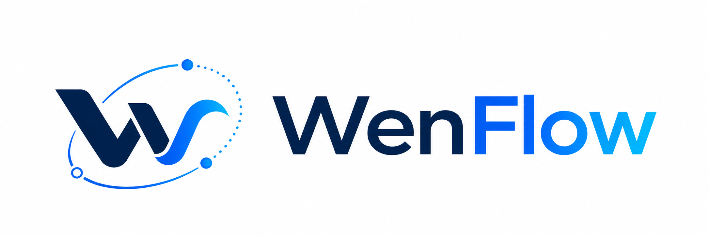
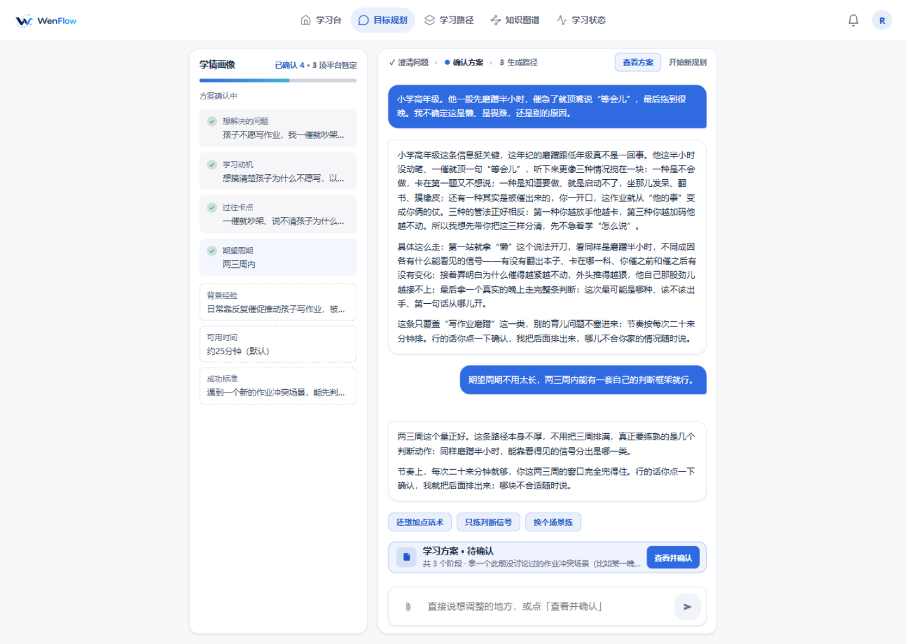
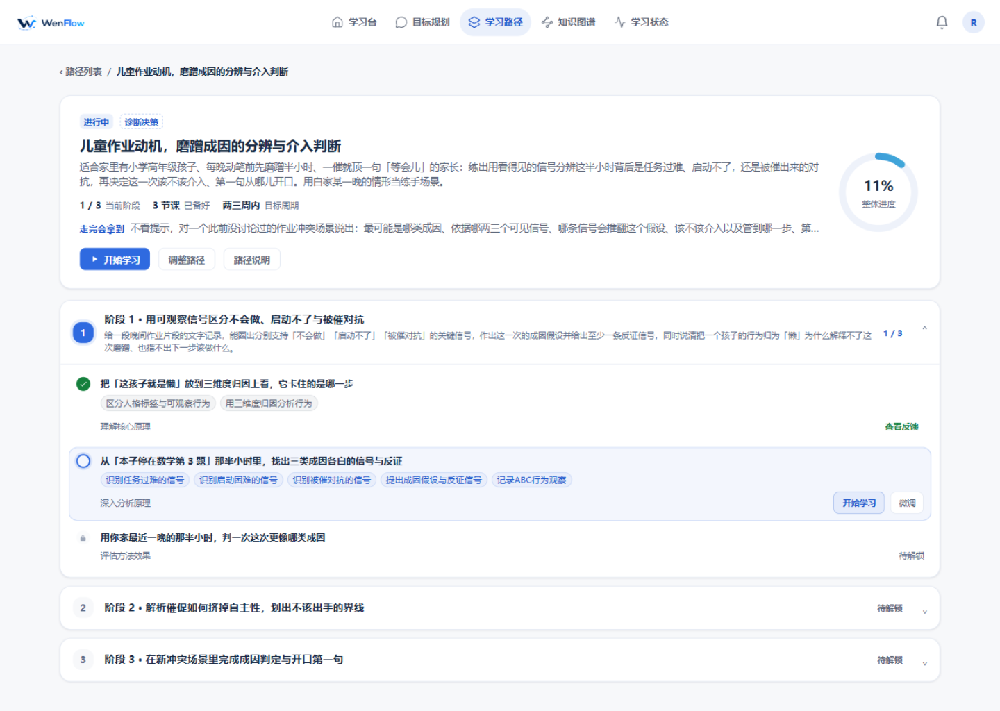
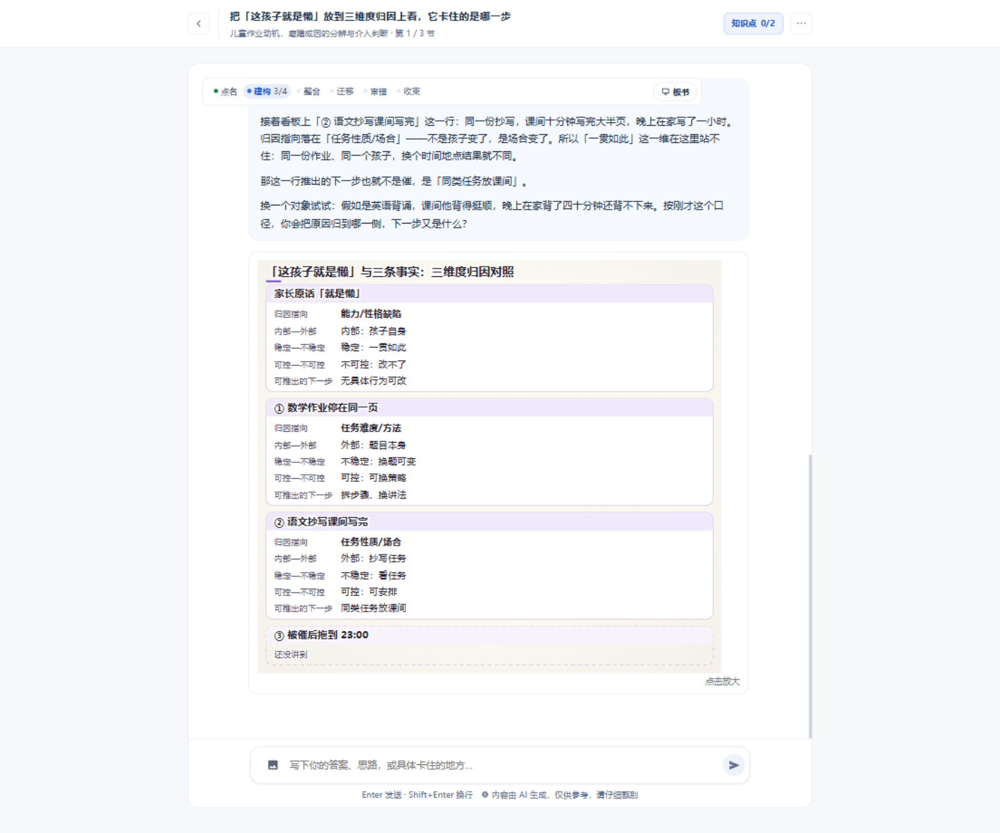
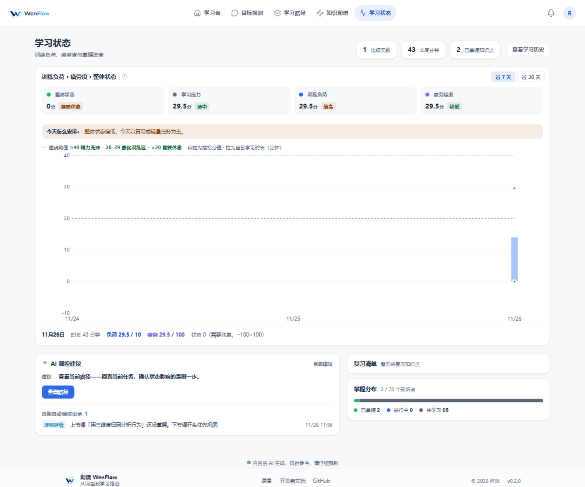
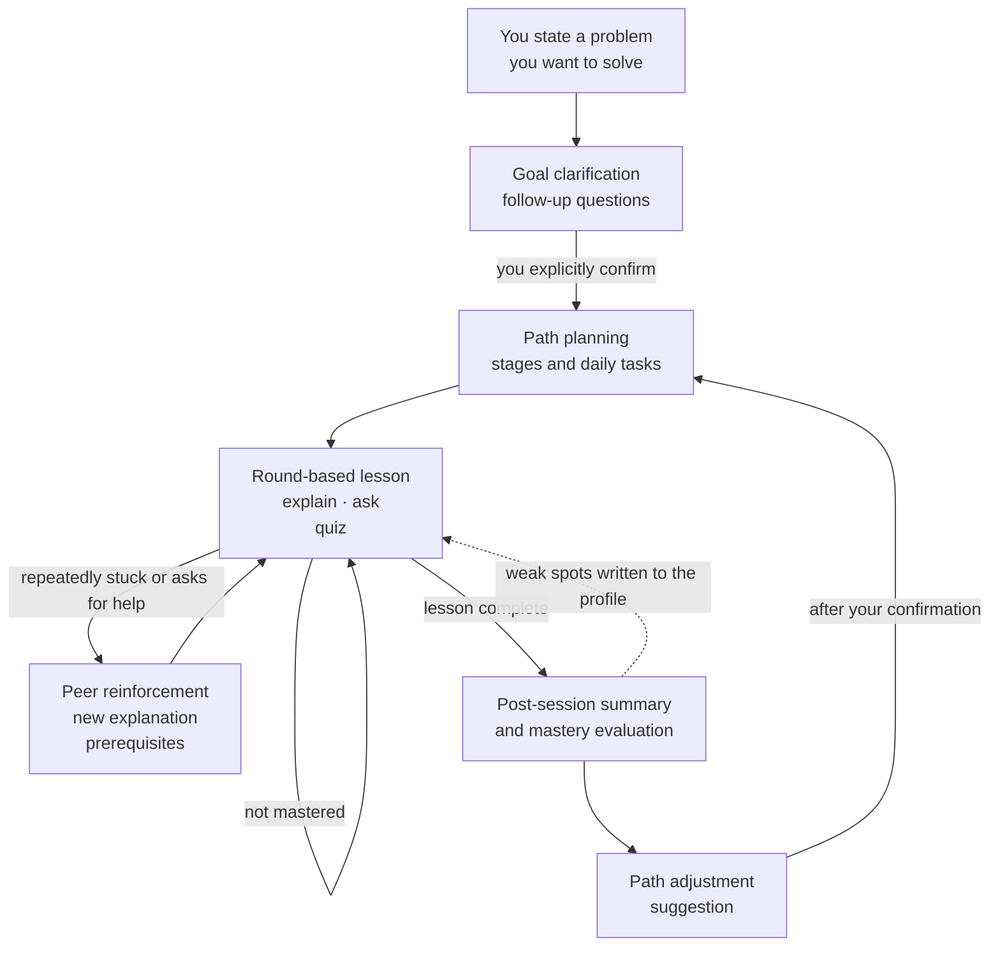

<div align="center">



**Say clearly what you want to solve before you start learning.**

**WenFlow** (问流) is an open-source, self-hostable AI-native learning platform: it talks a vague goal into focus,
builds a learning path from it, teaches in round-based lessons with a whiteboard, schedules reviews
along the forgetting curve, and manages your pace with a training-load model.

[](https://wenflow.org)
[](LICENSE)
[](https://github.com/wenflow-org/wenflow/actions/workflows/quality-check.yml)

English · [中文](README.md) · [Quick start](#quick-start)

</div>

Try it at [wenflow.org](https://wenflow.org). The demo is for evaluation only; accounts and data are purged periodically, so do not store anything important there.

## What makes it "AI-native"

Most learning trouble is not a lack of effort: the goal is too big, there is too much material, and the first step is unclear. Traditional platforms start from supplying content, with courses, question banks and paths prepared in advance. WenFlow has no pre-built courses: clarifying the goal, planning the path, teaching and the post-session summary are all done by AI around the problem you actually have.

## How is it different from just asking an AI?

Why not just throw the question at an AI assistant? You get an answer fast, but these parts are still on you:

| | Asking a general AI assistant | Using WenFlow |
|---|---|---|
| **Set the goal** | You decide what to learn and how far | Questions turn a vague goal into a verifiable one; you confirm it |
| **Plan** | The plan is yours to keep and push forward | A phased path is generated; today's task is right there |
| **Learn** | Question and answer, with no check that you really got it | Round-based lessons: explain, then ask; a new angle or missing prerequisites when stuck |
| **Remember you** | Your learning progress is not tracked by default | Weak spots are remembered and picked up next lesson; reviews follow the forgetting curve |
| **Pace** | Not concerned with how tired you are | Training load and fatigue are tracked; you are told to ease off when pushing too hard |

The thinking behind the project is on the [vision page](https://wenflow.org/vision) (Chinese).

## Walk through a real goal

Take the goal "my weekly Excel report takes too long; I want to automate it with Python":

|  |  |
|---|---|
|  |  |

- **① Clarify the goal** (top left): questions before answers. Background, motivation, time available each day. After 7 rounds the goal narrows to "get a first working script within 4 weeks".
- **② Generate the path** (top right): lessons are planned only after you confirm: 4 stages and 19 lessons, paced at 40 minutes on weekdays.
- **③ Lessons with a whiteboard** (bottom left): flows, comparisons and mappings are drawn on the board as they come up and updated as the lesson advances; explain, then ask, with immediate feedback.
- **④ Learning state** (bottom right): training load and fatigue trends, with a nudge to slow down when you push too hard.

The screenshots are in Chinese; the UI is currently Chinese-only.

Also:

- **Your own materials**: upload the course notes or book you are studying, and lessons retrieve and quote the relevant passages instead of stuffing the whole book into the model.
- **Your own key**: any OpenAI-compatible provider works, and learners can bring their own API key in settings.
- **Your own data**: SQLite files with no external database service; MIT licensed and fully self-hostable.

## Quick Start

All you need is an API key for an OpenAI-compatible endpoint. [DeepSeek](https://platform.deepseek.com/) is the default, and any compatible provider can be configured in the admin console.

### Docker (Linux / macOS)

```bash
git clone https://github.com/wenflow-org/wenflow.git
cd wenflow
./docker-start.sh
```

On first run the script walks you through `backend/.env`: enter an `AI_API_KEY` and the remaining secrets are generated. Then open [http://localhost](http://localhost).

### Local development (Windows / Linux / macOS)

Prerequisite: **Node.js >= 22.23.4** (check with `node -v`).

```bash
# 1) Clone and install (always npm ci; see "Common pitfalls" below for why)
git clone https://github.com/wenflow-org/wenflow.git
cd wenflow
npm ci && npm --prefix backend ci && npm --prefix frontend ci

# 2) Configure backend/.env
#    Windows: interactive wizard; JWT_SECRET and the encryption key are generated, you only enter AI_API_KEY
npm run env:setup
#    Linux / macOS: the wizard is a PowerShell script, so configure by hand
#    cp backend/.env.example backend/.env
#    Fill in at least these four:
#      JWT_SECRET=<random string, 32+ chars>
#      SECRET_ENCRYPTION_CURRENT_KEY_ID=v1
#      SECRET_ENCRYPTION_KEYS=v1:<32-byte Base64>
#      AI_API_KEY=<real key>
#    Generate random values:
#      node -e "console.log(require('crypto').randomBytes(48).toString('base64'))"
#      node -e "console.log('v1:'+require('crypto').randomBytes(32).toString('base64'))"

# 3) One-command start (migrates both databases, syncs built-in prompts, then starts both ends)
npm run dev
```

Then open:

- Learner app: http://localhost:5173
- Admin console: http://localhost:5173/admin (sign in with the admin account set in the previous step)
- Backend API: http://localhost:3001

> If it will not start or behaves oddly, run `npm run doctor` first: read-only, takes seconds, and checks Node / dependencies / `.env` / both databases / CORS / ports with fix suggestions.
> For everything that can be configured from zero to a working deployment (required / optional enhancements / access topology), see [`DEPLOYMENT.md`](DEPLOYMENT.md) (Chinese).

<details>
<summary><b>Fresh-machine checklist (tested 2026-11-11: empty AI key + no plugin keys)</b></summary>

| Item | Required? | Test result |
|---|---|---|
| Node.js >= 22.23.4 + npm | Yes | Older versions fail at the Prisma / Vite stage |
| `backend/.env` | Yes | Missing file stops the start script; Linux/macOS must create it by hand in step 2 |
| `JWT_SECRET` (32+ chars) | Yes | Missing or weak value fails fast |
| `SECRET_ENCRYPTION_CURRENT_KEY_ID` + `SECRET_ENCRYPTION_KEYS` | Yes | Validated by `runtime:validate` inside `prisma:prepare`; missing keys exit |
| `DATABASE_URL` / `SYSTEM_DATABASE_URL` | Yes | Defaults `file:./dev.db` / `file:../system.db`; SQLite needs no external database |
| `AI_API_URL` / `AI_API_KEY` / `AI_MODEL` | Yes for the one-command start; no for the backend process | With an empty key the backend still reports `/readyz` = `ready`, but `aiConfiguration` = `warning` and goal/path/teaching calls are unavailable. Windows `npm run dev` blocks an empty key; Linux `start-dev.sh` does not |
| Embedding / Rerank | No | Boots normally when empty; semantic retrieval and rerank fail open to keyword/window paths |
| Web / decision / image / MCP plugins | No | A fresh DB enables all four bundles; without keys the page shows "missing key". Disabling all four and restarting still reaches `ready`. MCP ships a local `file-reader` tool that can be disabled or deleted |
| `INIT_ADMIN_PASSWORD` | No in development / yes in production | Development falls back to a built-in default; production skips admin creation when empty |

**UI/admin-only boot without an AI key**: Windows `npm run dev` blocks an empty `AI_API_KEY`; bypass the one-command script with:

```bash
npm --prefix backend run prisma:prepare
npm --prefix backend run dev:server   # 3001
npm --prefix frontend run dev         # 5173
```

The backend still lets you log in, open plugin configuration and every read-only page; `/readyz` keeps `aiConfiguration=warning` and all AI calls are unavailable.

</details>

<details>
<summary><b>First run and common pitfalls</b></summary>

- **Always use `npm ci`, never `npm install`.** The lockfile contains mirror-sourced optional / peer entries (e.g. `@parcel/watcher`, `@bufbuild/protobuf`); `npm install` rewrites the lockfile from the current resolution and drops those entries in bulk (hundreds of deleted lines that are not real code changes). To install manually: `npm ci && npm --prefix backend ci && npm --prefix frontend ci`.
- `npm run dev` already runs `prisma:prepare` (generate both Prisma clients + deploy migrations for both databases). Only if you start things step by step, or explicitly skip it (PowerShell `./start-dev.ps1 -SkipPrisma`, bash `./start-dev.sh --skip-prisma`), do you need to run `npm --prefix backend run prisma:prepare` yourself.
- The skip option also skips the pre-start core-prompt sync and is only meant for environments where the databases and prompts are already prepared.
- On Windows, a missing `backend/.env` or an invalid `JWT_SECRET` makes `start-dev.ps1` launch the setup wizard; Linux/macOS `start-dev.sh` does not generate secrets, so fill them in by hand as in step 2.
- **Empty AI key boundary**: the backend process starts, but `npm run dev` (Windows) blocks it before launch. Use the step-by-step commands above for UI/admin-only acceptance. Do not use a placeholder key to pretend it is configured — `sk-your-api-key` is treated as missing.
- **Ports**: the default ports are 3001 (backend) and 5173 (frontend). If either is occupied, the one-command start exits; stop the old process first.
- If npm 11.16+ prints `allow-scripts ... not yet covered`, install scripts for packages such as Prisma / esbuild were skipped. Follow the prompt (`npm approve-scripts --allow-scripts-pending`) and re-run `npm ci`. On this machine Prisma generation, Vite dev and the frontend build still worked with those scripts skipped, but approving them is the safer troubleshooting path.
- Health probes: `/health` and `/livez` only mean the process is alive; `/readyz` means both databases and core runtime state can serve traffic. To restart the backend use the single entry point `node backend/restart.mjs --port=<port>` (`--status` to inspect, `--stop` to stop); do not kill ports by hand or start with a bare `ts-node`.

</details>

## Project Status

WenFlow is built by a single independent developer and has been iterating since its first version in April 2026. It is still an early-stage experiment for validating a teaching concept: interfaces, database schemas and the prompt protocol may change.

Validation relies mainly on the built-in AI Virtual Learner Lab; the public demo site ([wenflow.org](https://wenflow.org)) lets you experience the full loop online.

- `main`: stable branch; this is what you clone by default
- `develop`: main development branch, where new features and day-to-day commits land

---

## Under the Hood

Being AI-native comes down to the engineering decisions below. From here on, this is written for developers and edtech peers; each item gets one sentence, and the details live in the linked documents (mostly Chinese).

| Topic | In one sentence | Go deeper |
|---|---|---|
| Lesson round protocol | Explain, ask and quiz advance round by round; repeated stalls switch to peer reinforcement, and mastery evidence is written back to the learner profile | [Agent / Skill manual](doc/AGENT_SKILL_MANUAL.md) |
| Learner model | Aggregates the long-term profile, recent state and per-path memory (FSRS-6 review scheduling) into one learner snapshot consumed by teaching and path replanning | [Learner model architecture](doc/LEARNER_MODEL_ARCHITECTURE.md) |
| Learning load model | Borrows the load / fatigue / form idea from endurance training, advances per day, and uses relative measures to decide "can more be added" | [Learner center and state fusion](doc/LEARNER_CENTER_AND_STATE_FUSION.md) |
| Virtual Learner Lab | Derives AI learners from role cards, runs the full learning flow black-box like a real user, then has an independent judge score the teaching | [Design](doc/VIRTUAL_LEARNER_DESIGN.md) · [Chain](doc/VIRTUAL_LEARNER_CHAIN.md) |
| Educational theory map | Every teaching design registers its theory source, literature and code location | [Theory map](doc/EDUCATIONAL_THEORY_MAP.md) |
| Path production and replanning | The contract for how paths are generated and when replanning is triggered | [Contract](doc/PATH_PRODUCTION_REPLAN_CONTRACT.md) |
| Prompts and Skills | File-as-Truth: YAML source → compiled artifacts → database mirror, with gates and one-click rollback | [Skill protocol v4](doc/SKILL_PROTOCOL_V4.md) · [Development guide](doc/SKILL_DEVELOPMENT_GUIDE.md) |
| Model gateway | OpenAI-compatible access with per-Agent / per-Skill model routing, SSE streaming, retry budget and thinking mode | [Gateway design](doc/MODEL_GATEWAY_DESIGN.md) |
| Classroom whiteboard | Theory basis and evidence grading for teaching diagrams | [Diagram pedagogy research](doc/DIAGRAM_PEDAGOGY_RESEARCH.md) |

<details>
<summary><b>How one lesson round runs</b></summary>

Each lesson advances in rounds: explain → ask → quiz.



- **It never acts on its own**: generating a path or changing a plan requires the learner's explicit confirmation.
- **Getting stuck is handled**: after repeated wrong answers or an explicit request for help, the session switches into peer reinforcement and rebuilds the missing prerequisites instead of pushing on.
- **Memory carries across lessons**: each session feeds the learner profile, so the next lesson picks up from the weak spots and schedules reviews according to memory science.
- **No walls of text**: the knowledge and length of each turn are capped, and long conversations are compressed automatically.

</details>

<details>
<summary><b>The four learning-load readings</b></summary>

People often quit after three days, not out of laziness but because they start too hard. WenFlow borrows the "load / fatigue / form" idea from endurance training and gives study intensity its own dashboard:

| Reading in the UI | Abbreviation | What it tells you |
|---|---|---|
| **Learning stress** | LSS | How hard this one lesson hit: computed from cognitive load, efficiency, duration, completion and task type |
| **Training load** | KTL | Accumulated long-term stress: moves slowly and reflects your recent base |
| **Fatigue** | LF | Accumulated recent stress: moves fast and climbs after several days in a row |
| **Overall state** | LSB | The combined reading: fresh, in the sweet spot, or time to rest; shows "building up" when you have just started and there is not enough data |

The four readings are on different scales, so the product only asks you to read trends, not to compare numbers. Verdicts use relative measures (how fast fatigue is rising against your base), so someone used to several lessons a day is not mistaken for being over-tired.

This is an engineering heuristic, not a medical or sports-science measurement. See `backend/src/services/learning/learning-load.pmc.ts` and `learning-load-verdict.ts`.

</details>

<details>
<summary><b>How the Virtual Learner Lab works</b></summary>

Without a large sample of real learners, how do you know whether the teaching works? The project ships a Virtual Learner Lab and lets AI play the student:

- **AI plays the learner**: a virtual learner with a background, a personality and a time budget is derived from a role card and runs the whole flow like a real user: clarify the goal, generate the path, attend lessons and answer questions.
- **Black-box simulation**: only actions visible through the product UI, with no data edits and no reading of internal state. An assisted mode runs the full chain once a person picks the story and the goal.
- **Independent judge**: after teaching ends, a judge that took no part in teaching, together with a role-fidelity audit, scores the teaching quality.
- **Role card library**: the repository ships cards covering academic subjects, engineering practice, exams, business diagnosis and more; a card is only a profile, and the account is created when a learner is derived from it.

A limitation worth knowing: virtual learners come with biases, and they are currently the main evaluation corpus, so a bias can be misread as a product trait. Known biases are quantified one by one in section 11 of the [design document](doc/VIRTUAL_LEARNER_DESIGN.md).

</details>

<details>
<summary><b>Admin console</b></summary>

Beyond the learner app there is an operations and observability console (`/admin`), all backed by real APIs:

- **Prompt Studio (File-as-Truth)**: edit prompts online, compile with gates, publish and roll back in one click; local YAML sources and the runtime mirror in the database stay in sync.
- **End-to-end observability**: token cost, model latency, agent execution chains and retry timelines for every call.
- **Model routing**: any OpenAI-compatible provider; fast or reasoning models can be assigned per Agent / Skill, and users can bring their own API key. Precedence: environment variables → platform defaults → Agent / Skill level → user overrides.
- **Operations workbench**: teaching sessions, learning-state risks, review backlog, feedback and announcements.

</details>

## Tech Stack

| Layer | Technology |
|------|------|
| **Frontend** | Vue 3 + TypeScript + Vite + Pinia |
| **Backend** | Node.js + Express + TypeScript + Prisma |
| **Database** | Two SQLite databases (main + system); no external database service needed |
| **AI access** | OpenAI-compatible gateway with SSE streaming, retry budget and thinking-mode control; Embedding / Rerank optional, failing open to keyword search when unconfigured |
| **Agent / Skill** | 5 top-level agents (goal / path / teaching / profile / simulation) + Skill execution layer + coordinators + persisted event chain |
| **Security** | JWT + CSRF + login rate limiting + Secret AES-256-GCM encryption + sensitive-storage permission audits |
| **Deployment** | Docker (Nginx + backend, only the Nginx port is published) or local `npm run dev` |

<details>
<summary><b>Project structure</b></summary>

```text
backend/            Node.js + Express + TypeScript backend
  src/
    agents/         top-level agents (including learner-model-agent / simulation-agent)
    skills/         skill implementations (prompt sources live in prompts/, not hard-coded here)
    coordinators/   business flow orchestration (goal / path / teaching / learner / simulation)
    gateway/        OpenAI-compatible model gateway
    routes/         HTTP routes (learner app / admin)
    services/       domain services and data access
    virtual-lab/    Virtual Learner Lab
    events/         persisted events and outbox
    scripts/        official tooling: gates / read-only audits / probes / backfills / ops
  prisma/           main DB schema and migrations; system/ holds the System DB
frontend/           Vue 3 + TypeScript + Vite frontend
  src/
    views/v2/             learner app pages
    views/admin-redesign/ admin pages and scene manifest.ts
    components/mk/        shared admin primitives (MkKpi / MkRowList / MkDistBand …)
    api/ · stores/ · router/ · composables/
prompts/            File-as-Truth prompts: core/*.yaml source → skill.*.md compiled artifacts
scripts/            repo-root scripts (runs / inspections / demos / gates), index in doc/DEV_SCRIPTS.md
virtual-learners/   virtual-learner material: presets.yaml + role card library cards/
doc/                documentation index at doc/README.md (process material lives in gitignored doc/local/)
.github/workflows/  CI gate quality-check.yml
```

</details>

<details>
<summary><b>Page map: learner app</b></summary>

Landing pages `/` and `/vision`, login `/login`, register `/register`; after signing in you land on the dashboard.

Five entries in the top / bottom navigation:

| Page | Path | Description |
|------|------|------|
| Dashboard | `/dashboard` | Today's actions, path progress, learning streak |
| Goal planning | `/goal-conversation` | Multi-round dialogue to clarify the real goal |
| Learning paths | `/learning-paths` | Path list and progress |
| Knowledge map | `/knowledge-map` | Aggregated knowledge view across all paths (in-lesson view shows only the current path) |
| Learning state | `/learning-state` | Training load, fatigue and mastery progress |

Core flow: register / log in → `/onboarding` → `/goal-conversation` → after your confirmation the path is generated → `/learning-paths` → `/learning-path/:id` → `/learn/:taskId` round-based learning → `/learn/:taskId/evaluation/:sessionId` post-session evaluation.

The personal centre lives under `/user/*`: account, settings (including API access), call logs, achievements, learning history, plus the library (`/library`, upload materials for "learning a course / a book" so lessons can reference them).

</details>

<details>
<summary><b>Page map: admin console</b></summary>

The admin console lives at `/admin`. The sidebar has five groups plus a pinned platform overview:

- **Operations**: operations centre (to-dos, feedback, achievements, announcements, notifications), system settings (models and access, data export, session security, access and registration), user accounts
- **Learning**: goal conversations, learning paths, teaching sessions, learning state, review backlog
- **Simulation**: virtual learners, session review reports, learner card library
- **Skill**: field flow, Skill catalogue, plugins
- **Observability and diagnosis**: execution logs, audit log, cost analysis, health centre

The authoritative scene list is [`frontend/src/views/admin-redesign/manifest.ts`](frontend/src/views/admin-redesign/manifest.ts); the history of pages added, retired, and redirected lives in [`CHANGELOG.md`](CHANGELOG.md).

</details>

## Operations

<details>
<summary><b>LAN development mode (phones / tablets)</b></summary>

```bash
npm run dev:lan                        # detect the LAN IP automatically
./start-lan.ps1 -LanIP 192.168.31.26   # or specify it manually
```

Adds the LAN IP to `CORS_ORIGIN` for multi-device testing of the learner app; it does not change the admin `ADMIN_ACCESS_MODE` restriction.

</details>

<details>
<summary><b>Local Nginx test deployment (HTTP)</b></summary>

```bash
npm run dev:nginx                          # requires nginx on PATH
./start-dev.ps1 -UseNginx -Domain test.example.com
./start-dev.ps1 -UseNginx -NginxExePath "C:\nginx\nginx.exe"
```

Builds the frontend and writes a runtime config to `runtime/nginx/wenflow.nginx.conf`; it checks that port 80 is free before starting.

</details>

<details>
<summary><b>Docker deployment (Linux / macOS)</b></summary>

```bash
./docker-start.sh        # interactively completes backend/.env, then starts
docker compose -f docker-compose.operations.yml run --rm backup   # DB backup (set WENFLOW_BACKUP_HOST_DIR first)
```

`docker-compose.yml` defines migrate / backend / nginx; it only publishes Nginx (80) and never publishes backend `3001`, and the backend is forced to `ADMIN_ACCESS_MODE=private`. See [`DEPLOYMENT.md`](DEPLOYMENT.md).

</details>

<details>
<summary><b>Quality gates (same as CI)</b></summary>

`npm run check` chains three stages, mirroring the three parallel CI jobs:

```bash
npm run check:quality   # secret scan → Prisma schema validation → empty-DB migration replay → typecheck (both ends) →
                        # LLM call contract → constant provenance → both migrations deployed → prompt gates →
                        # design-system guard → route/DB boundary → dev-entrypoint guard → doc dead links → lint
npm run check:test      # backend + frontend tests with coverage
npm run check:build     # backend + frontend builds
npm run check           # all three in order (equivalent to CI)
```

CI (`.github/workflows/quality-check.yml`) runs on push to main/master/develop and on PRs; when it fails, `npm run ci:status` shows the failing job, step, and error lines.

</details>

<details>
<summary><b>Prompt bootstrap and maintenance (File-as-Truth)</b></summary>

The source of truth is `prompts/core/*.yaml` (the only hand-edited entry point, tracked in git); compiled artifacts are `prompts/skill.*.md` (the only text the model reads); the `agent_prompts` table in the database is a runtime mirror. The edit → compile → publish chain (with gates and rollback) is operated from the admin Prompt Studio; the mechanism is documented in [`doc/SKILL_PROTOCOL_V4.md`](doc/SKILL_PROTOCOL_V4.md) and the directory notes in [`prompts/_README.md`](prompts/_README.md).

```bash
cd backend
npm run prompts:compile-all    # core/*.yaml → skill.*.md (does not touch the DB)
npm run prompts:sync-core      # sync the ACTIVE version in the DB (also runs on startup)
npm run prompts:backfill-core  # after an upgrade, add only new nodes without overwriting ACTIVE
npm run prompts:lint && npm run prompts:core:check
```

</details>

<details>
<summary><b>Data and storage</b></summary>

Two SQLite databases; relative URLs resolve against their own schema directory:

| Database | Schema | Env var | Default path |
|----|--------|----------|----------|
| Main | `backend/prisma/schema.prisma` | `DATABASE_URL` | `file:./dev.db` |
| System | `backend/prisma/system/schema.prisma` | `SYSTEM_DATABASE_URL` | `file:../system.db` |

- Migrations and checks: `npm run prisma:migrate:verify-clean` (empty-DB replay), `npm run prisma:baseline:audit` (read-only audit), `npm --prefix backend run prisma:migrate:deploy:all`
- Backup and maintenance: `npm run database:backup:create` / `database:backup:verify` / `database:vacuum:status` / `database:vacuum`
- **After switching worktrees or moving the directory, the app may connect to the wrong database**: the generated Prisma client records the relative path at generation time in `node_modules/.prisma/client/index.js`, so the app can keep resolving to another tree's DB while the CLI migrates the current one. Fix it by regenerating in the current workspace: `npm --prefix backend run prisma:prepare`.
- Do not use the legacy `file:./prisma/*.db`, and do not change the System URL to `file:./system.db`.

</details>

<details>
<summary><b>Frontend API environment variables</b></summary>

- By default the frontend calls the backend through the relative `/api` path, proxied by Vite or Nginx; keep the default unless you have a specific deployment need.
- The only recognised setting is `VITE_API_BASE_URL` (`frontend/.env`); development always goes through the `/api` proxy, which is also the default.

</details>

<details>
<summary><b>Admin account and reverse proxy</b></summary>

The initial admin is created from `backend/.env` on first start (`INIT_ADMIN_NAME` / `INIT_ADMIN_PASSWORD`; skipped if an admin already exists). Change the password right after the first login.

Admin login defaults to `ADMIN_ACCESS_MODE=private` (local machine and LAN only); it can be set to `loopback` or `any`, with `ADMIN_ALLOWED_IPS` for exact allowances. The policy can be changed live from the admin “Models and Access” page. For remote administration over the public internet, pair it with a VPN or an exact IP allowlist. See [`doc/ADMIN_OPERATIONS_MANUAL.md`](doc/ADMIN_OPERATIONS_MANUAL.md).

Reverse proxy notes:

- Do not add a trailing `/` to `CORS_ORIGIN` (`https://demo.example.com`, not `https://demo.example.com/`)
- Set `TRUST_PROXY` to the IP/CIDR of the proxy that connects directly to the backend; never `true` in production
- Do not expose a backend port that can bypass the proxy (Docker publishes only Nginx)
- On “origin not allowed”, compare the browser `Origin` with `CORS_ORIGIN` first

</details>

<details>
<summary><b>Command index</b></summary>

The full list lives in the root `package.json` and [`doc/DEV_SCRIPTS.md`](doc/DEV_SCRIPTS.md) (script directories, run pipelines, tool index):

| Category | Command | Notes |
|------|------|------|
| Start | `npm run dev` / `dev:win` / `dev:unix` | Cross-platform / Windows / Linux·macOS |
| Start | `npm run dev:lan` / `dev:nginx` | LAN debugging / local Nginx test deployment |
| Backend restart | `node backend/restart.mjs --port=3011` | Single entry: type check → stop old process → start → wait for `/readyz`; `--status` to inspect, `--stop` to stop |
| Doctor | `npm run doctor` | Read-only health check; `-- --deep` also audits prompts |
| Gates | `npm run check` | `check:quality` + `check:test` + `check:build` |
| Tests | `npm run test` / `test:coverage` | Backend Jest (CI uses `--runInBand`) / with coverage |
| Security | `npm run security:scan` / `permissions:audit` / `secrets:audit` | Secret scan / permission audit / secret migration audit (`*:repair`, `*:migrate` are the writing counterparts) |
| Ops | `npm run ci:status` | Recent CI failures by job, step, and error line |

</details>

## Documentation

- Documentation index: [`doc/README.md`](doc/README.md) (organised as “living specs / design traces / historical snapshots”; Chinese)
- Deployment / security / operations: [`DEPLOYMENT.md`](DEPLOYMENT.md) · [`SECURITY.md`](SECURITY.md) · [`doc/ADMIN_OPERATIONS_MANUAL.md`](doc/ADMIN_OPERATIONS_MANUAL.md)
- Development scripts: [`doc/DEV_SCRIPTS.md`](doc/DEV_SCRIPTS.md)
- Changelog: [`CHANGELOG.md`](CHANGELOG.md)
- Contributing: [`CONTRIBUTING.md`](CONTRIBUTING.md) (branch model, quality gates, commit conventions, shared-worktree discipline)

## License

Released under the [MIT License](LICENSE).

Copyright (c) 2026 wenflow-org

## Acknowledgements

Thanks to the [Linux.do](https://linux.do/) community for their long-term support and feedback.

---

*When AI can answer every standard question, the people who ask good questions will define the future.*
