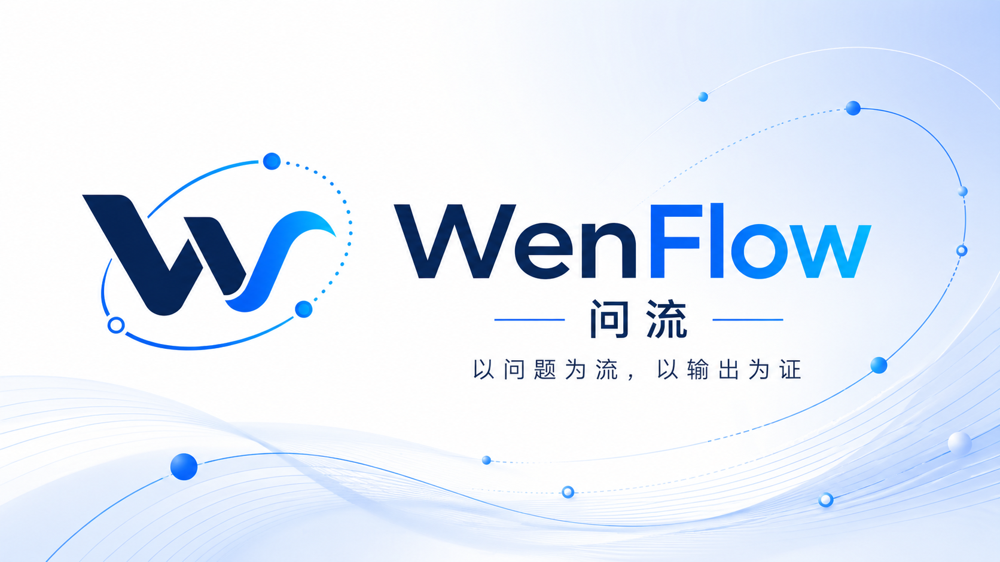
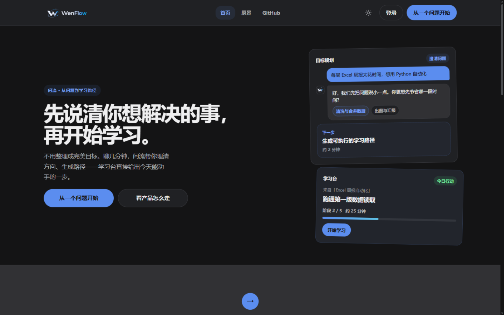
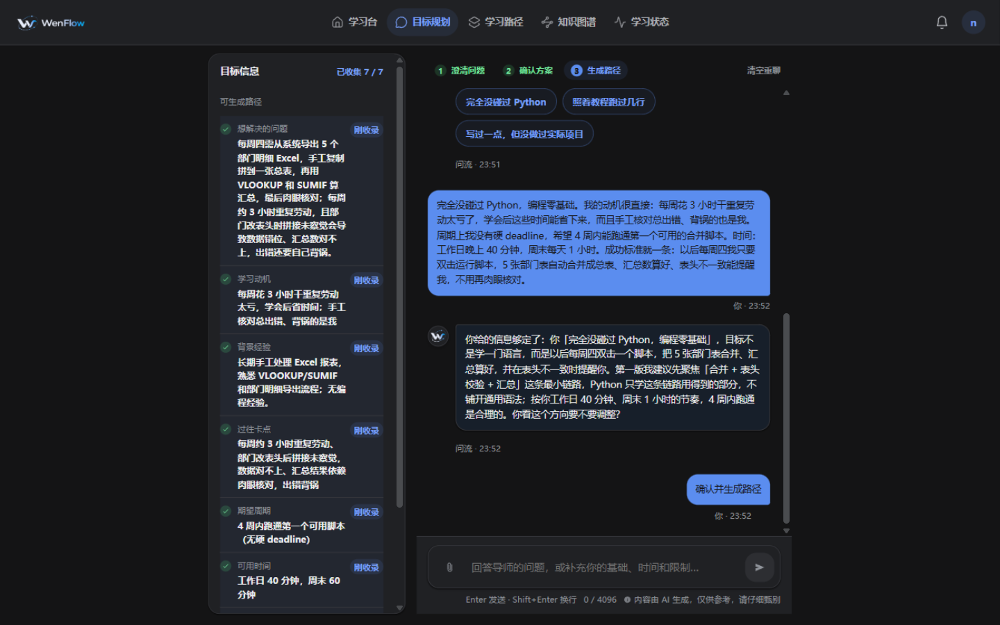
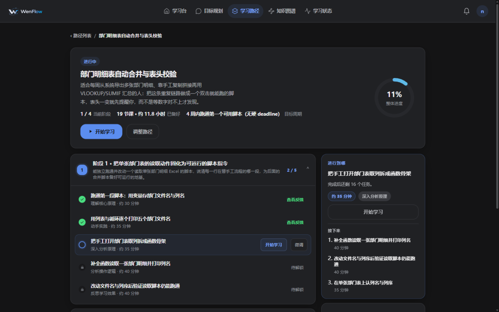
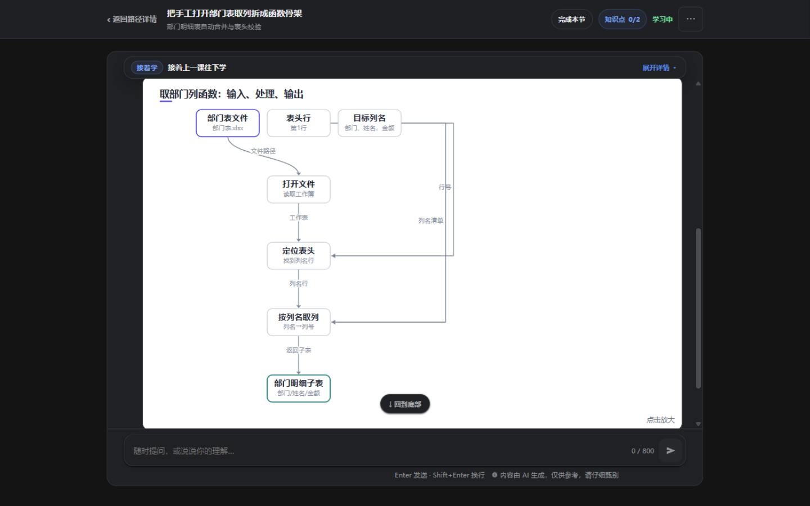
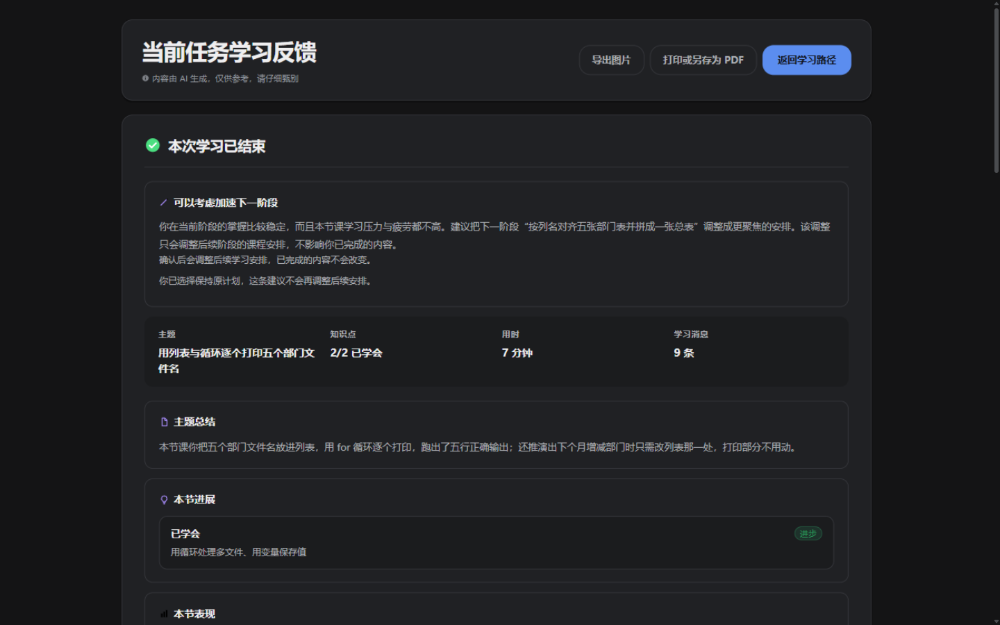
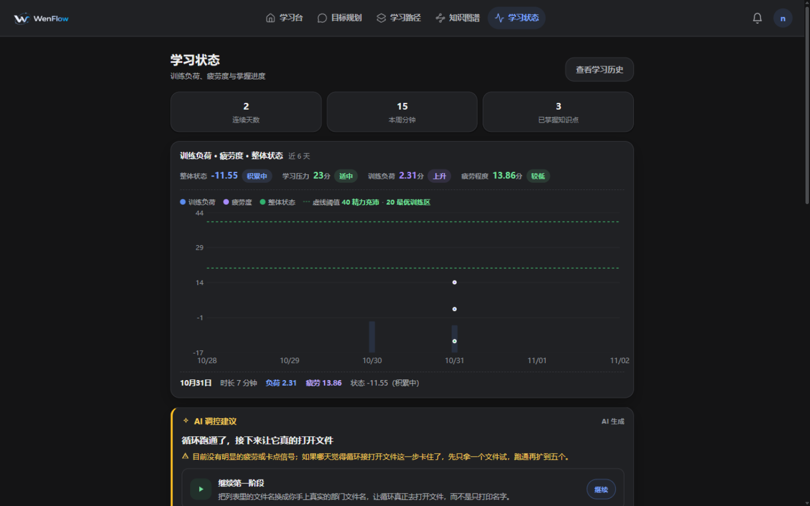
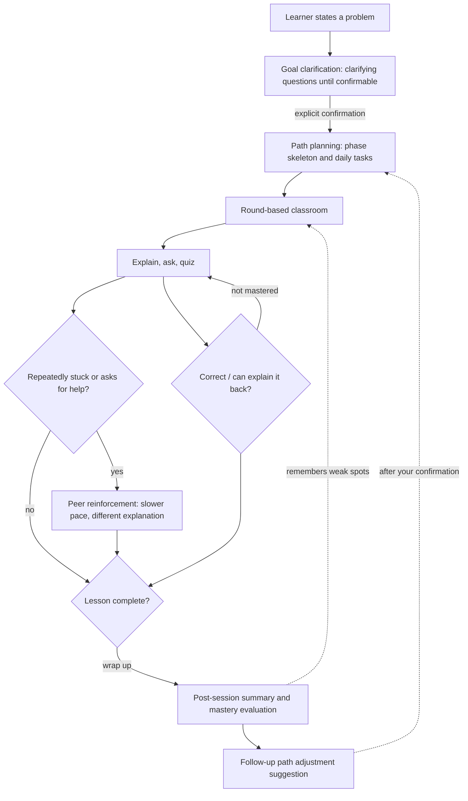

# WenFlow



> ⚠️ **Current Main Development**: [develop](https://github.com/wenflow-org/wenflow/tree/develop) branch | main is stable

**An AI learning-support service platform that starts from real problems**

> Core idea: learning begins with clarifying the real problem, not with choosing a course.

English Version | [中文版](README.md)

🌐 **Demo Site**: https://wenflow.org

> Demo only, not for production use, and all accounts and data are periodically purged. Do not store important information.

[](LICENSE)
[](https://nodejs.org)
[](https://vuejs.org)

📋 **[Changelog](CHANGELOG.md)** · Monthly feature updates

---

## Why WenFlow?

Many learning difficulties stem not from a lack of effort, but from goals that are too broad, an overload of materials, and an unclear first step.

Most learning products start by supplying content: courses, materials, exercises, and predefined paths. WenFlow takes a different approach — it first helps learners clarify the problem they actually need to solve, then generates an actionable learning path from it, refined continuously through dialogue, output, and feedback.

As AI becomes increasingly capable of producing answers, the skills worth cultivating are no longer limited to memorizing content, but:

- **problem definition**: turning a vague goal into an explorable question
- **systems thinking**: understanding the structural relationships between knowledge, context, and action
- **judgment**: discerning what is worth trusting amid information overload
- **AI collaboration**: treating AI as a partner for questioning, feedback, and reasoning
- **creativity**: making new connections between existing knowledge

**Answers will become increasingly abundant; the quality of the questions will matter more.**

---

## Core Experience Preview

These six screenshots show WenFlow's core experience, from a real problem to a complete learning loop.

| ① Start from a Real Problem |
|:---:|
|  |
| Learners state their problem first, rather than choosing a course |

| ② Clarify the Real Goal | ③ Generate a Learning Path |
|:---:|:---:|
|  |  |
| The AI clarifies the real goal through multi-round questioning | A vague goal becomes phases, tasks, and an actionable first step |

| ④ Enter Round-based Learning | ⑤ Learning Loop Overview |
|:---:|:---:|
|  |  |
| The AI teaches, the learner answers, and feedback is immediate; teaching adapts dynamically | A post-session summary and evaluation provide guidance on what to learn next |

| ⑥ Learning State Tracking |
|:---:|
|  |
| LSS / KTL / LF / LSB tracked continuously, with rest prompts when fatigue is detected |

---

## Highlights

### 1. A multi-agent classroom that actually teaches

Most AI teaching tools are a chat box with a prompt attached, and the conversation drifts. WenFlow runs on an explicit division of labour and a round-based protocol:



- **It never acts on its own**: generating a path or changing a plan requires the learner's explicit confirmation.
- **Getting stuck is handled**: after repeated wrong answers or an explicit request for help, the session switches into peer reinforcement and rebuilds the missing prerequisites instead of pushing on.
- **Memory carries across lessons**: each session feeds the learner profile, so the next lesson picks up from the weak spots and schedules reviews according to memory science.
- **A whiteboard that draws along**: when the tutor hits structural content, the classroom whiteboard puts a figure on the board (script-line-to-manual-step mappings, flow loops, side-by-side comparisons), moving the cognitive weight of dense text onto the board; the board keeps updating as the lesson advances and can be zoomed in.

### 2. Managing cognitive load like physical training load

People often quit after three days, not out of laziness but because they start too hard. WenFlow borrows the load-and-recovery model from endurance sports and gives study intensity its own dashboard:

| Metric | Full name | In plain words |
|------|------|------|
| **LSS** | Learning Stress Score | How hard today's session hit: computed from task difficulty, duration, cognitive load, and completion rate |
| **KTL** | Knowledge Training Load | Your long-term base: accumulated study load with daily decay retention (half-life ≈ 13.5 days) |
| **LF** | Learning Fatigue | How tired you are right now: short-term accumulated fatigue (half-life ≈ 1.9 days) that spikes when you study back-to-back |
| **LSB** | Learning State Balance | Whether you can take more: KTL − LF; when low, the platform warns against over-learning and suggests rest or review |

### 3. Educational theory that lands in code

WenFlow's teaching behaviour is not prompt guesswork; each design point has a theory behind it (11 of them map directly to product behaviour, and the full 16 with literature links are in [`doc/EDUCATIONAL_THEORY_MAP.md`](doc/EDUCATIONAL_THEORY_MAP.md)):

- **Cognitive load theory**: caps the knowledge points and length of each turn, compresses long conversations instead of flooding the screen
- **Zone of proximal development + scaffolding**: difficulty rises and falls with demonstrated understanding, and prerequisites are rebuilt when progress stalls
- **Feynman technique + retrieval practice**: being able to explain it back and pass the in-session check is what counts, not a feeling of “I get it”
- **Productive failure**: try first, then compare and integrate with the AI, turning wrong answers into understanding
- **Spacing and the review loop**: reviews are scheduled across days by the FSRS-6 memory model (replacing the earlier SM-2-style fixed multiplier), so knowledge is maintained rather than consumed once

### 4. Virtual Learner Lab

To validate teaching quality without a large human sample, the project ships a Virtual Learner Lab: the library comes seeded with 200 default golden role cards (different backgrounds and personalities, **pure profiles** — auto-loaded on first start), and an account is only created when a learner is derived from a card. Virtual learners then run the full flow like real users — clarify the goal, generate the path, attend the lesson — while an independent judge and a role-fidelity audit score the teaching.

- **Black-box simulation**: only actions visible through the product UI, no data edits, no reading internal state
- **Quick Learn**: pick a task, complete one lesson automatically, and get a report for fast regression

### 5. An admin console with 19 scene pages

Beyond the learner app there is a full operations and observability console (`/admin`), all backed by real APIs:

- **Prompt Studio (File-as-Truth)**: edit prompts online, compile with gates, publish and roll back in one click; local YAML sources and the runtime mirror in the database stay in sync
- **End-to-end observability**: token cost, model latency, agent execution chains and retry timelines for every call
- **Model routing**: any OpenAI-compatible provider, defaulting to `deepseek-v4.1-flash`; fast or reasoning models can be assigned per agent, and users can bring their own API key

---

## Quick Start in 3 Minutes

Requirements: **Node.js >= 22.23.4**; Windows (PowerShell 5.1+), Linux, or macOS; on Linux/macOS you can also run `./docker-start.sh` to use Docker.

```bash
# 1) Clone
git clone https://github.com/wenflow-org/wenflow.git
cd wenflow

# 2) Initialise config (set the AI API key and the admin password)
npm run env:setup

# 3) One-command start (installs dependencies, initialises both databases, syncs built-in prompts, then starts both ends)
npm run dev
```

Then open:

- Learner app: http://localhost:5173
- Admin console: http://localhost:5173/admin (log in with the admin account you just set)
- Backend API: http://localhost:3001

> If it will not start or behaves oddly, run `npm run doctor` first: read-only, takes seconds, and checks Node / dependencies / `.env` / both databases / CORS / ports with fix suggestions.

<details>
<summary><b>First run and common pitfalls (click to expand)</b></summary>

- **Always use `npm ci`, never `npm install`.** The lockfile contains mirror-sourced optional / peer entries (e.g. `@parcel/watcher`, `@bufbuild/protobuf`); `npm install` rewrites the lockfile from the current resolution and drops those entries in bulk (hundreds of deleted lines that are not real code changes). To install manually: `npm ci && npm --prefix backend ci && npm --prefix frontend ci`.
- `npm run dev` already runs `prisma:prepare` (generate both Prisma clients + deploy migrations for both databases). Only if you start things step by step, or explicitly skip it (PowerShell `./start-dev.ps1 -SkipPrisma`, bash `./start-dev.sh --skip-prisma`), do you need to run `npm --prefix backend run prisma:prepare` yourself.
- The skip option also skips the pre-start core-prompt sync and is only meant for environments where the databases and prompts are already prepared.
- If `backend/.env` is missing or `JWT_SECRET` is invalid, the start script launches the setup flow automatically.
- Health probes: `/health` and `/livez` only mean the process is alive; `/readyz` means both databases and core runtime state can serve traffic. To restart the backend use the single entry point `node backend/restart.mjs --port=<port>` (`--status` to inspect, `--stop` to stop); do not kill ports by hand or start with a bare `ts-node`.

</details>

---

## Project Status

WenFlow is independently developed by a single author and has been iterating since its first version in April 2026. Functional validation is done primarily through the built-in AI Virtual Learner Lab, and the public demo site ([wenflow.org](https://wenflow.org)) lets you experience the full loop online.

The project is not a simple acceleration of existing learning workflows; it explores an alternative path — starting from real problems, with AI helping to clarify goals, shape the path, and organize feedback — to determine whether this approach is better suited to the AI era.

The project will continue to explore how to cultivate five capabilities that matter in the AI era: **problem definition, systems thinking, judgment, AI collaboration, and creativity**.

---

## Tech Stack

| Layer | Technology |
|------|------|
| **Frontend** | Vue 3 + TypeScript + Vite 6 + in-house Mk* admin primitives + lucide icons + Pinia |
| **Backend** | Node.js + Express + TypeScript + Prisma |
| **Database** | SQLite, dual-database architecture (main DB: 54 models; system DB: 15 tables), runs with no external database service |
| **AI Integration** | Four model families: ① chat / reasoning / evaluation LLMs — OpenAI-compatible gateway (defaults all deepseek-v4.1-flash) with SSE streaming, retry budget, thinking-mode control; ② infrastructure models — Embedding / Rerank (defaults bge-m3 / bge-reranker-v2-m3) powering semantic material search and reranking, fail-open to keyword fallback when unconfigured; ③ decision model (decision-gate, material-quality gate judgements); ④ image generation (text-to-image plugin). Families ②③④ are optional and degrade by documented semantics when unconfigured |
| **Agent / Skill** | 5 top-level agents (goal / path / teaching / profile / simulation) + Skill execution layer (prompt source `prompts/core/*.yaml` → compiled artifacts → database mirror) + coordinators + persisted event chain |
| **Model Config Layers** | Env vars → platform defaults → Agent/Skill level → user-defined API and model overrides |
| **Virtual Experiment** | Virtual Learner Lab (black-box simulation + Quick Learn) |
| **Observability** | Agent/Skill call logs, trace waterfall, LLM execution details |
| **Security** | JWT + CSRF + login rate limiting + Secret AES-256-GCM encryption + sensitive-storage permission audits |
| **Deployment** | Cross-platform start script (`npm run dev`) + optional Nginx test deployment + Docker (recommended for Linux/macOS) |

<details>
<summary><b>Project structure (click to expand)</b></summary>

```text
backend/            Node.js + Express + TypeScript backend
  src/
    agents/         top-level agents (including learner-model-agent / simulation-agent)
    skills/         skill implementations (prompt sources live in prompts/, not hard-coded here)
    coordinators/   business flow orchestration (goal / path / teaching / learner / simulation)
    gateway/        OpenAI-compatible model gateway
    routes/         HTTP routes (learner app / admin)
    services/       domain services and data access
    virtual-lab/    Virtual Learner Lab
    events/         persisted events and outbox
    scripts/        official tooling: gates / read-only audits / probes / backfills / ops
  prisma/           main DB schema and migrations; system/ holds the System DB
frontend/           Vue 3 + TypeScript + Vite 6 frontend
  src/
    views/v2/             learner app pages
    views/admin-redesign/ admin pages and scene manifest.ts
    components/mk/        shared admin primitives (MkKpi / MkRowList / MkDistBand …)
    api/ · stores/ · router/ · composables/
prompts/            File-as-Truth prompts: core/*.yaml source → skill.*.md compiled artifacts
scripts/            repo-root scripts (runs / inspections / demos / gates), index in doc/DEV_SCRIPTS.md
virtual-learners/   preset virtual-learner material presets.yaml + golden card library cards/ (200 default golden cards, auto-seeded on first start)
doc/                documentation index at doc/README.md (process material lives in gitignored doc/local/)
.github/workflows/  CI gate quality-check.yml
```

</details>

---

## Page Map

<details>
<summary><b>Learner app (click to expand)</b></summary>

Landing pages `/` and `/vision`, login `/login`, register `/register`, then the V2 shell.

Five entries in the top / bottom navigation:

| Page | Path | Description |
|------|------|------|
| Dashboard | `/dashboard` | Today's actions, path progress, learning streak |
| Goal planning | `/goal-conversation` | Multi-round dialogue to clarify the real goal |
| Learning paths | `/learning-paths` | Path list and progress |
| Knowledge map | `/knowledge-map` | Aggregated knowledge view across all paths (in-lesson view shows only the current path) |
| Learning state | `/learning-state` | LSS / KTL / LF / LSB with fatigue alerts |

Core flow: register / log in → `/onboarding` → `/goal-conversation` → after your confirmation the path is generated → `/learning-paths` → `/learning-path/:id` → `/learn/:taskId` round-based learning → `/learn/:taskId/evaluation/:sessionId` post-session evaluation.

The personal centre lives under `/user/*`: account, settings (including API access), call logs, achievements, learning history. Legacy `/v2/*` URLs redirect to the current paths.

</details>

<details>
<summary><b>Admin console scenes (click to expand)</b></summary>

The admin console lives at `/admin` with **19 scene pages in 7 groups** (plus one hidden “operations glossary” used only by the header help entry):

- **Overview**: platform overview with today's health, the models with the highest failure rates, and open items
- **Learning**: goal conversations, learning paths, teaching sessions, learning state (risk and fatigue, with manual snapshot recompute), review backlog
- **Simulation**: virtual learners (runtime: concurrency quota / global rate limit / instance stream / batch creation, single-step test), learner card library (pure-profile role cards: structured import/export, one-click load of the 200 golden presets; accounts are created only when deriving learners from cards)
- **Skill**: field flow (phase swimlanes + field data journey and logic graph + call usage), skill catalogue (skill runtime + model routing; prompt evaluation as a tab; the skill-design sub-page covers protocol editing, compile, gates, publish, rollback, trial run), plugins (keys / MCP / web access / decision / image-generation extensions)
- **Observability & diagnosis**: execution logs (log / trace tabs with retry timeline, auto refresh, export), audit log, cost analysis, health centre, models and access (chat gateway routing / infrastructure models Embedding·Rerank / connectivity / network boundary / retry timeout)
- **Operations**: operations centre (todo workbench / feedback / achievements / announcements / notifications / data export / session security / ops tools tabs), user accounts

The authoritative scene list is [`frontend/src/views/admin-redesign/manifest.ts`](frontend/src/views/admin-redesign/manifest.ts); the history of pages added, retired, and redirected lives in [`CHANGELOG.md`](CHANGELOG.md).

</details>

---

## Advanced Deployment and Operations

<details>
<summary><b>LAN development mode (phones / tablets)</b></summary>

```bash
npm run dev:lan                        # detect the LAN IP automatically
./start-lan.ps1 -LanIP 192.168.31.26   # or specify it manually
```

Adds the LAN IP to `CORS_ORIGIN` for multi-device testing of the learner app; it does not change the admin `ADMIN_ACCESS_MODE` restriction.

</details>

<details>
<summary><b>Local Nginx test deployment (HTTP)</b></summary>

```bash
npm run dev:nginx                          # requires nginx on PATH
./start-dev.ps1 -UseNginx -Domain test.example.com
./start-dev.ps1 -UseNginx -NginxExePath "C:\nginx\nginx.exe"
```

Builds the frontend and writes a runtime config to `runtime/nginx/wenflow.nginx.conf`; it checks that port 80 is free before starting.

</details>

<details>
<summary><b>Docker deployment (Linux / macOS)</b></summary>

```bash
./docker-start.sh        # interactively completes backend/.env, then starts
docker compose -f docker-compose.operations.yml run --rm backup   # DB backup (set WENFLOW_BACKUP_HOST_DIR first)
```

`docker-compose.yml` defines migrate / backend / nginx; it only publishes Nginx (80) and never publishes backend `3001`, and the backend is forced to `ADMIN_ACCESS_MODE=private`. See [`DEPLOYMENT.md`](DEPLOYMENT.md).

</details>

<details>
<summary><b>Quality gates (same as CI)</b></summary>

`npm run check` chains three stages, mirroring the three parallel CI jobs:

```bash
npm run check:quality   # secret scan → Prisma schema validation → empty-DB migration replay → typecheck (both ends) →
                        # LLM call contract → constant provenance → both migrations deployed → prompt gates →
                        # design-system guard → route/DB boundary → dev-entrypoint guard → doc dead links → lint
npm run check:test      # backend + frontend tests with coverage
npm run check:build     # backend + frontend builds
npm run check           # all three in order (equivalent to CI)
```

CI (`.github/workflows/quality-check.yml`) runs on push to main/master/develop and on PRs; when it fails, `npm run ci:status` shows the failing job, step, and error lines.

</details>

<details>
<summary><b>Prompt bootstrap and maintenance (File-as-Truth)</b></summary>

The source of truth is `prompts/core/*.yaml` (the only hand-edited entry point, tracked in git); compiled artifacts are `prompts/skill.*.md` (the only text the model reads); the `agent_prompts` table in the database is a runtime mirror. The edit → compile → publish chain (with gates and rollback) is operated from the admin Prompt Studio; the mechanism is documented in [`doc/SKILL_PROTOCOL_V4.md`](doc/SKILL_PROTOCOL_V4.md) and the directory notes in [`prompts/_README.md`](prompts/_README.md).

```bash
cd backend
npm run prompts:compile-all    # core/*.yaml → skill.*.md (does not touch the DB)
npm run prompts:sync-core      # sync the ACTIVE version in the DB (also runs on startup)
npm run prompts:backfill-core  # after an upgrade, add only new nodes without overwriting ACTIVE
npm run prompts:lint && npm run prompts:core:check
```

</details>

<details>
<summary><b>Data and storage</b></summary>

Two SQLite databases; relative URLs resolve against their own schema directory:

| Database | Schema | Env var | Default path | Tables |
|----|--------|----------|----------|------|
| Main | `backend/prisma/schema.prisma` | `DATABASE_URL` | `file:./dev.db` | 51 (+1 runtime table) |
| System | `backend/prisma/system/schema.prisma` | `SYSTEM_DATABASE_URL` | `file:../system.db` | 14 |

- Migrations and checks: `npm run prisma:migrate:verify-clean` (empty-DB replay), `npm run prisma:baseline:audit` (read-only audit), `npm --prefix backend run prisma:migrate:deploy:all`
- Backup and maintenance: `npm run database:backup:create` / `database:backup:verify` / `database:vacuum:status` / `database:vacuum`
- **After switching worktrees or moving the directory, the app may connect to the wrong database**: the generated Prisma client records the relative path at generation time in `node_modules/.prisma/client/index.js`, so the app can keep resolving to another tree's DB while the CLI migrates the current one. Fix it by regenerating in the current workspace: `npm --prefix backend run prisma:prepare`.
- Do not use the legacy `file:./prisma/*.db`, and do not change the System URL to `file:./system.db`.

</details>

<details>
<summary><b>Frontend API environment variables</b></summary>

- By default the frontend calls the backend through the relative `/api` path, proxied by Vite or Nginx; keep the default unless you have a specific deployment need.
- The admin console mainly reads `VITE_API_BASE_URL` from `frontend/.env`; the learner app uses `/api` in development, and in non-development builds `VITE_API_BASE_URL` takes precedence while `VITE_API_URL` remains only for backward compatibility.

</details>

<details>
<summary><b>Admin account and reverse proxy</b></summary>

The initial admin is created from `backend/.env` on first start (`INIT_ADMIN_NAME` / `INIT_ADMIN_PASSWORD`; skipped if an admin already exists). Change the password right after the first login.

Admin login defaults to `ADMIN_ACCESS_MODE=private` (local machine and LAN only); it can be set to `loopback` or `any`, with `ADMIN_ALLOWED_IPS` for exact allowances. The policy can be changed live from the admin “Models and Access” page. For remote administration over the public internet, pair it with a VPN or an exact IP allowlist. See [`admin-guide.md`](admin-guide.md).

Reverse proxy notes:

- Do not add a trailing `/` to `CORS_ORIGIN` (`https://demo.example.com`, not `https://demo.example.com/`)
- Set `TRUST_PROXY` to the IP/CIDR of the proxy that connects directly to the backend; never `true` in production
- Do not expose a backend port that can bypass the proxy (Docker publishes only Nginx)
- On “origin not allowed”, compare the browser `Origin` with `CORS_ORIGIN` first

</details>

<details>
<summary><b>Command index</b></summary>

The full list lives in the root `package.json` and [`doc/DEV_SCRIPTS.md`](doc/DEV_SCRIPTS.md) (script directories, run pipelines, tool index):

| Category | Command | Notes |
|------|------|------|
| Start | `npm run dev` / `dev:win` / `dev:unix` | Cross-platform / Windows / Linux·macOS |
| Start | `npm run dev:lan` / `dev:nginx` | LAN debugging / local Nginx test deployment |
| Backend restart | `node backend/restart.mjs --port=3011` | Single entry: type check → stop old process → start → wait for `/readyz`; `--status` to inspect, `--stop` to stop |
| Doctor | `npm run doctor` | Read-only health check; `-- --deep` also audits prompts |
| Gates | `npm run check` | `check:quality` + `check:test` + `check:build` |
| Tests | `npm run test` / `test:coverage` | Backend Jest (CI uses `--runInBand`) / with coverage |
| Security | `npm run security:scan` / `permissions:audit` / `secrets:audit` | Secret scan / permission audit / secret migration audit (`*:repair`, `*:migrate` are the writing counterparts) |
| Ops | `npm run ci:status` | Recent CI failures by job, step, and error line |

</details>

---

## Design Documentation

The documentation index is [`doc/README.md`](doc/README.md), organised as “living specs / design traces / historical snapshots”. Common entry points:

- **Where educational theory lands**: [`doc/EDUCATIONAL_THEORY_MAP.md`](doc/EDUCATIONAL_THEORY_MAP.md)
- **Agent / Skill**: [`doc/AGENT_SKILL_MANUAL.md`](doc/AGENT_SKILL_MANUAL.md) (why), [`doc/SKILL_PROTOCOL_V4.md`](doc/SKILL_PROTOCOL_V4.md) (protocol), [`doc/SKILL_DEVELOPMENT_GUIDE.md`](doc/SKILL_DEVELOPMENT_GUIDE.md) (building or changing a skill)
- **Architecture and models**: [`doc/MODEL_GATEWAY_DESIGN.md`](doc/MODEL_GATEWAY_DESIGN.md), [`doc/LEARNER_MODEL_ARCHITECTURE.md`](doc/LEARNER_MODEL_ARCHITECTURE.md)
- **Development scripts**: [`doc/DEV_SCRIPTS.md`](doc/DEV_SCRIPTS.md)
- **Deployment / security / admin**: [`DEPLOYMENT.md`](DEPLOYMENT.md), [`SECURITY.md`](SECURITY.md), [`admin-guide.md`](admin-guide.md)
- **Contributing**: [`CONTRIBUTING.md`](CONTRIBUTING.md) (branch model `develop` → `main`, gates and collaboration)
- **For AI coding sessions**: [`CLAUDE.md`](CLAUDE.md) (documentation governance, shared-worktree discipline)
- **Changelog**: [`CHANGELOG.md`](CHANGELOG.md)

---

## License

Released under the [MIT License](LICENSE).

Copyright (c) 2026 wenflow-org

---

## Acknowledgments

Thanks to the [Linux.do](https://linux.do/) community for their long-term support and feedback.

---

*When AI can answer every standard question, the people who ask good questions will define the future.*
