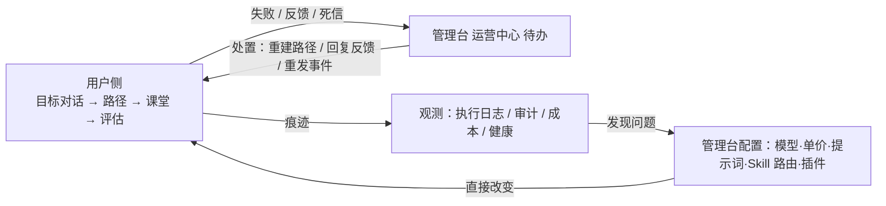
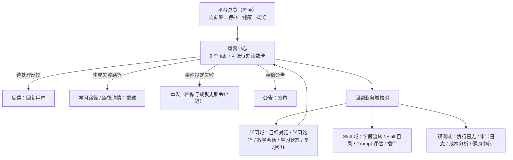

# 管理台旅程地图（运营 / 管理员视角）

> 📌 类型：活规范（地图）｜最后核验：2026-11-02。索引见 [doc/README.md](./README.md)。

> 这份文档回答一个问题：**管理员进来做什么、每天按什么顺序走、每个页面负责哪一段、哪些操作会真的改到用户侧。**
> 只覆盖运营/管理员侧；学习者侧见 [USER-JOURNEY-MAP-2026-11-01.md](./USER-JOURNEY-MAP-2026-11-01.md)。

- 版本：2026-11-02（2026-11-01 初稿；2026-11-02 按实测审计修订：待办读数卡页级化、死信落点、skill-workbench 层级、成本分析拆回、重定向表补录）
- 事实来源：路由 `frontend/src/router/index.ts`、侧栏单一数据源 `frontend/src/views/admin-redesign/manifest.ts`、页面注册表 `AdminConsole.vue`、运营中心 `OpsHub.vue`、后端挂载 `backend/src/bootstrap/routers.ts`
- 核实方式：页面清单取自侧栏登记表与页面注册表（两处互为镜像）；动作取自组件里真实存在的按钮与处理函数。凡本文没写到的页面动作，是**没有逐页核实**，不是「没有」。

---

## 1. 它是什么（和用户侧的关系）

管理台不是「用户侧的超管版」，而是三件事：

1. **处置台**：用户侧跑不动的地方（路径生成失败、收尾失败、反馈没人回）在这里变成待办。
2. **配置台**：模型与上游、单价、提示词版本、Skill 路由、插件——这些一改，用户侧课堂立刻不一样。
3. **观测台**：执行日志、审计日志、成本、健康检查。

所以两侧的关系是**闭环**，不是并列：

---

## 2. 身份与门禁（和用户会话完全分开）

| 项 | 说明 |
|---|---|
| 入口 | `/admin/login`，与用户 `/login` 是两套 |
| 会话 | 独立 admin 会话：后端要求 `isAdmin && sessionType === 'admin'` 才放行 |
| 中间件链 | 管理端路由统一五重：访问限制 → 认证 → 角色 → **审计** → 请求上下文 |
| 后果 | 管理端的操作会留审计；用户令牌拿不到管理端接口，反之亦然 |
| 旧链接 | 大量旧路径由 router 重定向到新位置，书签仍可达（清单见第 6 节） |

---

## 3. 运营日的循环（主路径）

侧栏分组本身就是一天的行动顺序：**看待办 → 处置 → 回到业务域核对**。

### 3.1 运营中心（`ops-hub`）承载了什么

一个宿主页里 9 个 tab：**运营待办 · 反馈 · 成就 · 公告 · 站内通知 · 运维工具 · 数据导出 · 会话安全 · 访问与注册**。

其中待办能力分两层：四张带计数的读数卡是**页级常驻**（2026-10-18 拍板，挂在页签栏之上），前 5 个页签——运营待办 · 反馈 · 成就 · 公告 · 站内通知——都能看见；**运维工具 · 数据导出 · 会话安全 · 访问与注册**这四个系统级页签与运营待办四域无关，会隐藏读数带（免得四个 0 占掉配置页首屏），每张卡都能一键跳到对应处置位置；「运营待办」页签本身是一张行动队列（2026-10-27 起，只列未清零/失败事项）。四张读数卡的文案与跳转：

| 待办卡 | 含义（卡上的原话） | 跳到 |
|---|---|---|
| 待处理反馈 | 用户反馈还没有人回复 | 反馈待处理列表 |
| 生成失败路径 | 学习者卡在路径生成，无法进入下一课 | 失败路径列表 |
| 事件投递失败 | 画像与成就更新会延迟 | 同页「运维工具」页签内的死信重放面板 |
| 草稿公告 | 公告尚未发布 | 公告页 |

> 注意：反馈、成就、公告、站内通知、会话安全、访问与注册这几个**已不再占侧栏席位**，它们的 URL 会重定向进运营中心；找它们请从运营中心的 tab 进。

---

## 4. 页面清单

### 置顶

| 页面 | URL | 用途 |
|---|---|---|
| 平台总览 | `/admin/overview` | 驾驶舱入口：待办、健康、整体概览 |

### 运营

| 页面 | URL | 用途 / 典型动作 |
|---|---|---|
| 运营中心 | `/admin/ops-hub` | 见 3.1；处置反馈、公告、通知、导出、会话安全、访问与注册都在这 |
| 模型与接入 | `/admin/api-config` | 供应商与模型、单价、密钥的配置；已核实动作：刷新注册表、获取模型、连接设置、测试连通性、重置通道，供应商启用/停用与模型测试/编辑/删除（无导入/导出入口） |
| 用户账号 | `/admin/people` | 账号管理；已核实动作：**新建用户**（另有账号侧面板与表单弹窗） |

### 学习（观察 + 下钻为主）

| 页面 | URL | 用途 |
|---|---|---|
| 目标对话 | `/admin/goal-conversations` | 看用户的目标澄清对话过程与结论 |
| 学习路径 | `/admin/learning-paths` | 路径总表（列：用户 / 状态 / 难度 / 预计时长 / 进度 / 最近活动），可按状态筛 |
| 教学会话 | `/admin/teaching-sessions` | 课堂会话总表：可按课型（含复习课）、时间（近 7 天 / 近 30 天）、状态（进行中 / 超时 / 初始化中…）筛；可标「关注」；收尾与评估状态在列内可见 |
| 学习状态 | `/admin/learner-state` | 学习者状态中心（干预、疲劳、风险等信号的入口页） |
| 复习积压 | `/admin/memory-review` | **跨用户**待复习量排行（按待复习量排序 + 到期时间轴）；单用户明细在学习者详情页签里 |

### 仿真

| 页面 | URL | 用途 |
|---|---|---|
| 虚拟学习者 | `/admin/virtual-learners` | 跑仿真：创建、导入/导出、运行态控制（见第 5 节） |
| 学习者卡库 | `/admin/virtual-learner-cards` | 角色卡的结构化导入/导出（卡 = 档案 + 故事池，不建账号） |

### Skill

| 页面 | URL | 用途 |
|---|---|---|
| 字段流转 | `/admin/orchestrator` | 编排与字段路由、管线；可编辑、重跑、回退 |
| Skill 目录 | `/admin/skills` | Skill 列表与详情（下钻二级页）；生成、同步、重试、回滚 |
| Prompt 评估 | `/admin/prompt-eval` | 用例与通过率评估 |
| 插件 | `/admin/addons` | 外挂能力：密钥、MCP、联网、生图等 |

### 观测与排查

| 页面 | URL | 用途 |
|---|---|---|
| 执行日志 | `/admin/execution-logs` | 调用链路、失败与重试（日志 / Trace 链路两个页签；成本分析已于 2026-09-29 拆回独立页 `/admin/token-cost`） |
| 审计日志 | `/admin/audit-logs` | 登录与操作记录 |
| 成本分析 | `/admin/token-cost` | Token 用量与单价 |
| 健康中心 | `/admin/health-center` | 检查、一致性、漂移；可发布 / 回退 |

### 隐藏页

| 页面 | URL | 说明 |
|---|---|---|
| 运营术语表 | `/admin/glossary` | 不进侧栏，由壳层帮助按钮进入 |
| Skill 工作台 | `/admin/skill-workbench` | 隐藏场景，是「新建 Skill」骨架生成的唯一入口，勿删 |

---

## 5. 干预能力的真实边界（容易误解，单独说明）

管理员**不能**接管真实学员的课堂。真实学员侧的证据面是**只读**的：教学会话页可以打开某节课的会话监控，但那是观察视图（页面上明确标注「只读」）。

真正带控制权的动作集中在两处：

1. **运营/配置类**：模型与接入（换上游/改单价/停用密钥）、Skill 域（提示词版本、字段路由、插件）、健康中心（发布/回退）、公告与通知、账号管理。这些是「改配置」，影响面是全体用户。
2. **仿真运行态**：虚拟学习者/会话驾驶舱里的运行控制——**暂停 / 继续 / 停止 / 重试 / 删除**，以及**重建学习路径 / 按评审意见重规划 / 按原输入重跑 / 终止黑盒实验 / 启动自动驾驶**。
   - 这些动作作用于**仿真会话**，不是真实学员。
   - 控制项的可用性由单一来源（`vlab-controls`）按运行状态派生：**状态没加载出来就不给动作**，不猜。
   - 破坏性动作（停止 / 重试等）先过确认弹窗，文案里写清影响。

---

## 6. 旧链接去哪了（router 兼容重定向）

这一区在路由文件里叫「旧 URL 别名区」，是**有意保留**的兼容层，不是残留物：每条「旧 → 新」都指向一个真实存在的页面。2026-11-01 复核过两点：

- **应用内部不用这些旧地址**。管理台自己跳转走的是 query 契约（例如打开 Skill 详情统一走 `/admin/skills?view=skill&id=…`，由健康中心、Skill 工作台、Skill 详情页共同遵守）。所以这一区只服务书签与外链。
- **删掉它会更差，不是更好**。管理台有一个兜底：`/admin/:page?` 会把任何未知 id 都接住，然后弹一条「未知管理页「xxx」，已回到总览」并把 URL 纠正到 `/admin/overview`。也就是说，一旦删掉别名，`/admin/users`、`/admin/feedback` 这类旧链接会**落到总览页**（只留一条转瞬即逝的提示），而现在是准确落到对应页面。所以这一区建议保留。

| 旧 URL | 现在到 |
|---|---|
| `/admin/console/:page` | `/admin/:page` |
| `/admin/users` · `/admin/learner-center` · `/admin/learner-models/:userId?` | `/admin/people` · `/admin/learner-state` |
| `/admin/sessions?tab=…` | `/admin/teaching-sessions` / `goal-conversations` / `learning-paths` |
| `/admin/topology` · `/admin/agent-registry/:agentId?` · `/admin/orchestration` | `/admin/orchestrator` |
| `/admin/prompt-workbench` · `/admin/skill-workbench/:agentId` | `/admin/skill-workbench` · `/admin/skills?view=skill&id=…` |
| `/admin/prompt-call-logs` · `/admin/traces` · `/admin/trace-waterfall` · `/admin/event-center` | `/admin/execution-logs` |
| `/admin/health` | `/admin/health-center`（query 透传） |
| `/admin/models` · `/admin/external-capabilities` | `/admin/api-config` · `/admin/addons` |
| `/admin/batch-experiments` · `/admin/virtual-session/:sessionId` | `/admin/virtual-learners`（后者带 `?view=session&id=…`） |
| `/admin/content` · `/admin/ops-content` | `/admin/learning-paths` |
| `/admin/feedback` · `/admin/announcements` · `/admin/notifications` · `/admin/messages` · `/admin/ops-achievements` · `/admin/achievements` · `/admin/session-security` · `/admin/access-control` · `/admin/ops-center` · `/admin/devtools` · `/admin/export-data` | `/admin/ops-hub`（按 tab 落到反馈 / 公告 / 站内通知 / 成就 / 会话安全 / 访问与注册 / 运维工具 / 数据导出） |
| `/admin/skills/:agentId+` | `/admin/skills?view=skill&id=…`（原 `?tab=` 映射进 `?skdTab=`） |
| `/admin/virtual-learners/:pathMatch(.*)+` | `/admin/virtual-learners` |

另有写在导航守卫里的 **query 级改投**（不在上表）：`/admin/skills?tab=health|drift|recon` → `/admin/health-center`；`/admin/skills?tab=prompt-eval` → `/admin/prompt-eval`；`/admin/api-config?tab=addons` → `/admin/addons`；`/admin/api-config?tab=security` → `/admin/ops-hub?tab=access`。

---

## 7. 已下线 / 已合并的场景

这些场景的**页面不再单独存在**，但业务能力都还在（挪进了宿主页的 tab）：

- 已下线并由 URL 改投：`feedback`、`ops-achievements`、`messages`、`session-security`、`access-control`、`ops-center`、`batch-experiments`。
- **例外：`skill-workbench` 没有下线**——它仍是隐藏的**一级场景页**（见 §4 隐藏页表，是「新建 Skill」骨架生成的唯一入口，勿删注册）。改投的只是它的旧详情深链 `/admin/skill-workbench/:agentId` → `/admin/skills?view=skill&id=…`，以及旧命名 `/admin/prompt-workbench` → `/admin/skill-workbench`（见第 6 节）。
- 已并入宿主：反馈 / 成就 / 公告 / 站内通知 / 运维工具 / 数据导出 / 会话安全 / 访问与注册 → 运营中心；记忆复习的单用户明细 → 学习者详情页签。（成本分析曾于 2026-09-04 并入执行日志，2026-09-29 已拆回独立页 `/admin/token-cost`。）

### 7.1 这一层「下线 + 保留别名」的代价在哪（2026-11-01 复核）

真正的风险不是别名本身，而是**兜底会掩盖死页**：`/admin/:page?` 接住任何 id 并回退总览，于是「页面没了」不会表现为 404，而是表现为**安静地显示总览**。这份文档成稿当天，就在两处巡检清单里抓到实例：

| 位置 | 问题 | 处置 |
|---|---|---|
| `backend/mcp-admin-health.test.ts` | 17 条页面里 **12 条指向已不存在的页面**（`/admin/dashboard`、`/admin/platform-capabilities`、`/admin/agent-registry`、`/admin/orchestrator-registry`、`/admin/orchestrator-definitions`、`/admin/skill-manager`、`/admin/skill-prompt-preview`、`/admin/prompt-call-logs`、`/admin/orchestrators`、`/admin/manifest-diagnostics`、`/admin/activity-stream`、`/admin/learner-models`）——因为回退总览，巡检照样打勾 | 改为以 `manifest.ts` 为准的真实场景清单（19 条） |
| `backend/admin-visual-check.test.ts` | 清单里混着 3 条**旧别名**（`/admin/users`、`/admin/learner-center`、`/admin/topology`）。该文件断言「URL 仍含目标 path」，而别名会把 URL 改写成新地址 → 这三条必然失败 | 换成 `people` / `learner-state` 等真实场景路径 |

同时核实：这两个文件**由 Playwright 收集**（`backend/playwright.config.ts`，`testMatch: ['mcp-*.test.ts', 'admin-visual-check.test.ts']`，`baseURL: http://localhost:5173`），需要先起前端 dev server 才能跑。它们不属 jest（jest 的 `roots` 只有 `src`），所以 `npm test` 看不到它们——这就是陈旧清单长期没被发现的原因：**修的是要手动跑 playwright 的那条路径**。

> 更正记录：本文档初稿在这一点上写错过一次（先判成「没有 runner」），复核 `backend/playwright.config.ts` 后纠正为上述结论。

---

## 8. 边界与未核实项

- **未逐页核实**：本文只对少量动作（新建用户、运营待办四卡、仿真运行控制、旧链接重定向）做到逐条对齐代码；Skill 域、模型与接入、健康中心的具体按钮清单未逐页穷举。
- 管理端与用户侧共用的组件（学习者详情页、会话驾驶舱）在不同入口下的权限差异未逐一验证。
- 本文不评价管理台的信息架构好坏，只描述「在哪、做什么」。
