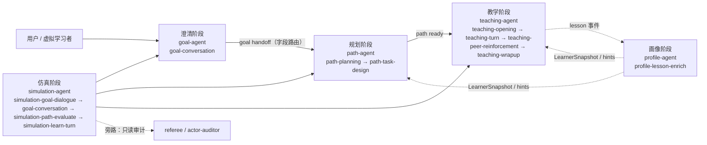

# 全管线地图：场景 → Agent → Skill/Prompt

> 📌 生成物｜场景/Agent/Prompt 全景索引（由 `pipeline:map` 生成，勿手改）
>
> 本文件由 `npm --prefix backend run pipeline:map` 从代码与 File-as-Truth 自动生成，**不要手改**。
> 数据源：`prompts/skills.yaml`、`prompts/orchestration/*.yaml`、`prompts/core/*.yaml`、`prompts/manifests/*.yaml`、`backend/src/coordinators/{goal,path,ai-teaching,learner,simulation}.definition.ts`、`doc/AGENT_SKILL_MANUAL.md（Agent 维度的"为什么"）`。

## 口径：为什么以「场景」为一级轴

运行时是按阶段推进的状态机（Goal → Path → Teaching），每阶段有自己的编排文件与执行体；
而且 `path-reviewer` / `path-kc-mapping` / `profile-learning-predict` / `profile-adaptive-copy` 等 Skill
是由 service 侧越步调用的，只看 Agent 的 `steps` 会漏掉真实调用点。因此：

1. **场景（阶段）** 回答"什么时候、按什么顺序发生"；
2. **Agent** 回答"谁拥有字段路由与生命周期"（为什么这样拆见 `doc/AGENT_SKILL_MANUAL.md`）；
3. **Prompt** 回答"具体改哪份文件"（正文唯一源在 `prompts/core/`，本图只做目录与契约索引）。

机器可读版本：`doc/pipeline-map.json`；提示词正文汇编（原文，按场景归档）：`doc/PIPELINE_PROMPTS.md`。



## 1. 阶段总览

| # | 阶段 | Agent | 调用顺序（agent steps） | 字段 / 路由 | 编排文件 |
| --- | --- | --- | --- | --- | --- |
| 1 | 澄清阶段 | `goal-agent` | `goal-conversation` | 48 / 78 | `prompts/orchestration/goal.yaml` |
| 2 | 规划阶段 | `path-agent` | `path-planning` → `path-task-design` | 47 / 53 | `prompts/orchestration/path.yaml` |
| 3 | 教学阶段 | `teaching-agent` | `teaching-opening` → `teaching-turn` → `teaching-peer-reinforcement` → `teaching-wrapup` | 51 / 58 | `prompts/orchestration/teaching.yaml` |
| 4 | 画像阶段 | `profile-agent` | `profile-lesson-enrich` | 21 / 33 | `prompts/orchestration/profile.yaml` |
| 5 | 仿真阶段 | `simulation-agent` | `simulation-goal-dialogue` → `goal-conversation` → `simulation-path-evaluate` → `simulation-learn-turn` → `simulation-referee` → `simulation-actor-audit` → `simulation-memory-curate` | 20 / 30 | `prompts/orchestration/simulation.yaml` |

> Goal/Path/Teaching 是纵向主链；Profile 是横切状态层（事件驱动）；Simulation 是目标函数相反的验证旁路。

## 2. 分阶段详情

### 1. 澄清阶段（`goal`）

目标对话：澄清目标、收集背景、收敛到方向方案

- **Agent**：`goal-agent` — Goal Agent
- **编排声明**：`prompts/orchestration/goal.yaml`（48 字段 / 78 条路由）
- **代码入口**：
  - 真实用户 Goal 对话（多轮状态机）：`backend/src/services/learning/goal-conversation.service.ts`
  - Goal → Path handoff（确定性定帧）：`backend/src/coordinators/path.coordinator.ts`

| 步 | 节点 | 类型 | 职责 | 条件 | 循环 |
| --- | --- | --- | --- | --- | --- |
| 1 | `skill:goal-conversation` | skill | goal-clarification | until goal confirmed | conversation-rounds |

| Skill | 类型 | 提示词正文 | 参数 | 输入/输出 | 字段角色 |
| --- | --- | --- | --- | --- | --- |
| `goal-conversation` | mainline | `prompts/core/goal-conversation.yaml` | temp=0.7 / retry | 3/8 | 11 |

> 「字段角色」= manifest `promptContract.fields` 的 direction/visibility 元数据；输出 schema 以 core.yaml 的 `fields` 为准，0 不代表没有输出契约。
### 2. 规划阶段（`path`）

学习路径生成：Framing → Path Planning → Stage Designer → Path Reviewer → KC Mapper

- **Agent**：`path-agent` — Path Generation Agent
- **编排声明**：`prompts/orchestration/path.yaml`（47 字段 / 53 条路由）
- **代码入口**：
  - 路径生成主链（path-planning → path-task-design）：`backend/src/services/learning/generation/path-generation.core.ts`
  - Path 协调与 handoff 装配：`backend/src/coordinators/path.coordinator.ts`
  - 路径重排（人工确认制）：`backend/src/services/learning/replan/path-replan.service.ts`

| 步 | 节点 | 类型 | 职责 | 条件 | 循环 |
| --- | --- | --- | --- | --- | --- |
| 1 | `PathCoordinator.buildFramedNormalizedInput` | service | input-framing | when goal handoff received | — |
| 2 | `skill:path-planning` | skill | cognitive-core-and-milestones | — | — |
| 3 | `skill:path-task-design` | skill | stage-task-expansion | — | milestones |

| Skill | 类型 | 提示词正文 | 参数 | 输入/输出 | 字段角色 |
| --- | --- | --- | --- | --- | --- |
| `path-planning` | mainline | `prompts/core/path-planning.yaml` | temp=0.5 / retry | 6/8 | 0 |
| `path-task-design` | mainline | `prompts/core/path-task-design.yaml` | temp=0.3 / retry | 11/1 | 0 |
| `path-reviewer` | mainline | `prompts/core/path-reviewer.yaml` | temp=0.3 / propagate | 3/5 | 0 |
| `path-kc-mapping` | mainline | `prompts/core/path-kc-mapping.yaml` | temp=0.3 / propagate | 4/3 | 0 |

> 「字段角色」= manifest `promptContract.fields` 的 direction/visibility 元数据；输出 schema 以 core.yaml 的 `fields` 为准，0 不代表没有输出契约。
**不在 Agent steps 内、但登记在本阶段的 Skill**：
- `path-reviewer`（mainline）— coordinator 登记（path-agent）：对路径生成结果做 CIDDP 五维度评审，低于阈值输出重规划指令
- `path-kc-mapping`（mainline）— coordinator 登记（path-agent）：将认知概念和子任务分解为细粒度 KC，标注前置依赖

### 3. 教学阶段（`teaching`）

授课执行：Teaching Turn → Peer/Checkpoint → Wrapup

- **Agent**：`teaching-agent` — AI Teaching Agent
- **编排声明**：`prompts/orchestration/teaching.yaml`（51 字段 / 58 条路由）
- **代码入口**：
  - 教学会话状态机（开课/回合/收束）：`backend/src/services/ai-teaching/AITeachingCoordinator.ts`
  - 课堂上下文构建（五输入通道）：`backend/src/services/ai-teaching/TeachingContextBuilder.ts`
  - 教学回合引擎（teaching-turn 调用点）：`backend/src/services/ai-teaching/teaching-turn-engine.ts`
  - 课后重排建议：`backend/src/services/ai-teaching/ReplanAdvisoryService.ts`

| 步 | 节点 | 类型 | 职责 | 条件 | 循环 |
| --- | --- | --- | --- | --- | --- |
| 1 | `TeachingContextBuilder` | service | teaching-context-build | — | — |
| 2 | `skill:teaching-opening` | skill | opening-generation | on session start | — |
| 3 | `skill:teaching-turn` | skill | teaching-turn-generation | — | messages |
| 4 | `skill:teaching-peer-reinforcement` | skill | teaching-peer-reinforcement | when control.shouldTriggerPeer = true | — |
| 5 | `AITeachingCoordinator.submitCheckpoint` | service | checkpoint-decision | when a pending checkpoint is returned | — |
| 6 | `skill:teaching-wrapup` | skill | teaching-wrapup | when session ends | — |
| 7 | `ReplanAdvisoryService` | service | replan-advisory | after wrapup and learner projection refresh | — |

| Skill | 类型 | 提示词正文 | 参数 | 输入/输出 | 字段角色 |
| --- | --- | --- | --- | --- | --- |
| `teaching-turn` | mainline | `prompts/core/teaching-turn.yaml` | temp=0.7 / retry | 7/8 | 15 |
| `teaching-peer-reinforcement` | mainline | `prompts/core/teaching-peer-reinforcement.yaml` | temp=0.7 / propagate | 7/2 | 0 |
| `teaching-wrapup` | mainline | `prompts/core/teaching-wrapup.yaml` | temp=0.7 / propagate | 7/2 | 0 |
| `teaching-opening` | aux | `prompts/core/teaching-opening.yaml` | temp=0.4 / propagate | 7/4 | 0 |

> 「字段角色」= manifest `promptContract.fields` 的 direction/visibility 元数据；输出 schema 以 core.yaml 的 `fields` 为准，0 不代表没有输出契约。
### 4. 画像阶段（`profile`）

学习者画像增强与背景知识沉淀，以及面向学习者的引导文案生成

- **Agent**：`profile-agent` — Learner State Agent
- **编排声明**：`prompts/orchestration/profile.yaml`（21 字段 / 33 条路由）
- **代码入口**：
  - outbox 事件消费注册：`backend/src/bootstrap/schedulers.ts`
  - 学习者快照刷新：`backend/src/services/learner/LearnerSnapshotRefreshService.ts`
  - 长期记忆写回：`backend/src/virtual-lab/learner-memory.ts`

| 步 | 节点 | 类型 | 职责 | 条件 | 循环 |
| --- | --- | --- | --- | --- | --- |
| 1 | `LearnerEvidenceProjector` | service | learner-evidence-projection | when learner profile related events arrive | — |
| 2 | `LearnerProfileService` | service | learner-profile-cache-clear | after learner evidence is projected | — |
| 3 | `LearnerSnapshotRefreshService` | service | learner-snapshot-refresh | after profile cache is invalidated (skipped for teaching task:completed / goal:understanding:updated) | — |
| 4 | `skill:profile-lesson-enrich` | skill | lesson-knowledge-enrichment | when lesson ends (enqueued asynchronously; the fast path does not await the LLM) | — |

| Skill | 类型 | 提示词正文 | 参数 | 输入/输出 | 字段角色 |
| --- | --- | --- | --- | --- | --- |
| `profile-adaptive-copy` | mainline | `prompts/core/profile-adaptive-copy.yaml` | temp=0.6 / propagate | 4/8 | 0 |
| `profile-lesson-enrich` | mainline | `prompts/core/profile-lesson-enrich.yaml` | temp=0.4 / propagate | 1/6 | 0 |
| `profile-learning-predict` | mainline | `prompts/core/profile-learning-predict.yaml` | temp=0.2 / propagate | 3/7 | 0 |

> 「字段角色」= manifest `promptContract.fields` 的 direction/visibility 元数据；输出 schema 以 core.yaml 的 `fields` 为准，0 不代表没有输出契约。
**不在 Agent steps 内、但登记在本阶段的 Skill**：
- `profile-adaptive-copy`（mainline）— coordinator 登记（profile-agent）：根据情境生成自适应引导话术
- `profile-learner-model`（handler-only）— coordinator 登记（profile-agent）：聚合学习者画像、状态与知识记忆（handler-only，无 LLM prompt）
- `profile-learning-predict`（mainline）— coordinator 登记（profile-agent）：任务前基于知识状态摘要预测卡壳风险，含实证校准闭环

### 5. 仿真阶段（`simulation`）

虚拟学习者实验：样本设计 → 模拟器 → 旁路审计（服务端注入输入，无阶段间 handoff）

- **Agent**：`simulation-agent` — Virtual Learner Simulation Agent
- **编排声明**：`prompts/orchestration/simulation.yaml`（20 字段 / 30 条路由）
- **代码入口**：
  - 仿真执行体（Goal/Path/Learn 驱动）：`backend/src/coordinators/simulation.execution.ts`
  - 自动驾驶（后台长任务/并发/恢复）：`backend/src/virtual-lab/autopilot.service.ts`
  - 旁路裁判/保真审计入口：`backend/src/routes/admin/session-audits.ts`

| 步 | 节点 | 类型 | 职责 | 条件 | 循环 |
| --- | --- | --- | --- | --- | --- |
| 1 | `skill:simulation-goal-dialogue` | skill | goal-stage-learner-turn-simulation | — | goal-rounds |
| 2 | `skill:goal-conversation` | skill | goal-clarification-and-convergence | — | goal-rounds |
| 3 | `path-agent` | service | teaching-path-generation | when goal stage converges | — |
| 4 | `skill:simulation-path-evaluate` | skill | legacy-assisted-path-review | legacy assisted mode only | — |
| 5 | `skill:simulation-learn-turn` | skill | teaching-stage-learner-turn-simulation | when teaching phase starts | teaching-turns |
| 6 | `teaching-agent` | service | teaching-session-execution | when teaching phase starts | teaching-turns |
| 7 | `skill:simulation-referee` | skill | platform-quality-referee | external: /api/admin/session-audits（裁判独立面，blackbox-api sessions only） | — |
| 8 | `skill:simulation-actor-audit` | skill | synthetic-learner-fidelity-audit | external: /api/admin/session-audits（裁判独立面，blackbox-api sessions only） | — |
| 9 | `skill:simulation-memory-curate` | skill | after-lesson-memory-curation | after a lesson/task completes in any chain | — |

| Skill | 类型 | 提示词正文 | 参数 | 输入/输出 | 字段角色 |
| --- | --- | --- | --- | --- | --- |
| `goal-conversation` | mainline | `prompts/core/goal-conversation.yaml` | temp=0.7 / retry | 3/8 | 11 |
| `simulation-persona-designer` | mainline | `prompts/core/simulation-persona-designer.yaml` | temp=0.8 / retry | 4/1 | 0 |
| `simulation-scenario-designer` | mainline | `prompts/core/simulation-scenario-designer.yaml` | temp=0.9 / retry | 10/3 | 0 |
| `simulation-goal-dialogue` | mainline | `prompts/core/simulation-goal-dialogue.yaml` | temp=0.8 / propagate | 9/6 | 0 |
| `simulation-path-evaluate` | mainline | `prompts/core/simulation-path-evaluate.yaml` | temp=0.5 / propagate | 7/3 | 0 |
| `simulation-learn-turn` | mainline | `prompts/core/simulation-learn-turn.yaml` | temp=0.7 / propagate | 15/6 | 0 |
| `simulation-referee` | mainline | `prompts/core/simulation-referee.yaml` | temp=0.2 / retry | 6/5 | 0 |
| `simulation-memory-curate` | mainline | `prompts/core/simulation-memory-curate.yaml` | temp=0.3 / propagate | 5/4 | 0 |
| `simulation-actor-audit` | mainline | `prompts/core/simulation-actor-audit.yaml` | temp=0.2 / retry | 6/5 | 0 |
| `simulation-epistemic-grounding` | mainline | `prompts/core/simulation-epistemic-grounding.yaml` | temp=0.3 / propagate | 9/1 | 0 |

> 「字段角色」= manifest `promptContract.fields` 的 direction/visibility 元数据；输出 schema 以 core.yaml 的 `fields` 为准，0 不代表没有输出契约。
**不在 Agent steps 内、但登记在本阶段的 Skill**：
- `simulation-persona-designer`（mainline）— coordinator 登记（simulation-agent）：为虚拟学习者生成稳定人格设定
- `simulation-scenario-designer`（mainline）— coordinator 登记（simulation-agent）：设计虚拟学习者的学习目标场景
- `simulation-epistemic-grounding`（mainline）— coordinator 登记（simulation-agent）：基于画像掌握度对当前步骤能否做对做离散认知判决（BEAGLE 物理两阶段第一段）

## 3. Prompt 全量清单

共 40 个已登记 Skill（mainline 20 / aux 9 / handler-only 11），其中 33 个有 LLM 提示词正文。

| Skill | 所属阶段（含复用） | Agent | 类型 | 规则/约束（条件） | 正文 | Manifest | 身份（首行） |
| --- | --- | --- | --- | --- | --- | --- | --- |
| `goal-conversation` | 澄清阶段、仿真阶段 | `goal-agent` | mainline | 50/3 | `prompts/core/goal-conversation.yaml` | `prompts/manifests/goal-conversation.yaml` | 学习目标澄清与方向收敛助手，通过自然对话澄清学习目标，信息足够时收敛到第一版学习方向。 |
| `path-planning` | 规划阶段 | `path-agent` | mainline | 60/4 | `prompts/core/path-planning.yaml` | `prompts/manifests/path-planning.yaml` | 一位认知建构师，负责先为用户的真实问题构建隐藏的认知图景，再据此设计一条阶段化的学习骨架。 |
| `path-task-design` | 规划阶段 | `path-agent` | mainline | 75/1（2） | `prompts/core/path-task-design.yaml` | `prompts/manifests/path-task-design.yaml` | 一位阶段任务设计师。 |
| `path-reviewer` | 规划阶段 | `path-agent` | mainline | 12/3 | `prompts/core/path-reviewer.yaml` | `prompts/manifests/path-reviewer.yaml` | 学习路径质量评审器。你评审的是 path-planning 生成的学习路径，不是直接面对用户。 |
| `path-kc-mapping` | 规划阶段 | `path-agent` | mainline | 15/11 | `prompts/core/path-kc-mapping.yaml` | `prompts/manifests/path-kc-mapping.yaml` | 对给定的认知核心（cognitiveCore）与任务列表（subtasks）做机器可读的结构标注： |
| `teaching-turn` | 教学阶段 | `teaching-agent` | mainline | 85/21（14） | `prompts/core/teaching-turn.yaml` | `prompts/manifests/teaching-turn.yaml` | 一位结构化教学回合生成器。 |
| `teaching-peer-reinforcement` | 教学阶段 | `teaching-agent` | mainline | 12/4 | `prompts/core/teaching-peer-reinforcement.yaml` | `prompts/manifests/teaching-peer-reinforcement.yaml` | 学习伙伴，和学生一起探索问题。 |
| `teaching-wrapup` | 教学阶段 | `teaching-agent` | mainline | 22/3（1） | `prompts/core/teaching-wrapup.yaml` | `prompts/manifests/teaching-wrapup.yaml` | 一位课后产出助手。请基于本节课的结构化证据生成课后总结与评估。 |
| `profile-adaptive-copy` | 画像阶段 | `profile-agent` | mainline | 13/2 | `prompts/core/profile-adaptive-copy.yaml` | `prompts/manifests/profile-adaptive-copy.yaml` | 一个学习产品的动态引导文案生成器。 |
| `profile-learner-model` | 画像阶段 | `profile-agent` | handler-only | 0/0 | — | — | — |
| `profile-lesson-enrich` | 画像阶段 | `profile-agent` | mainline | 10/2（1） | `prompts/core/profile-lesson-enrich.yaml` | `prompts/manifests/profile-lesson-enrich.yaml` | 课后知识增强器。一节课结束后，你基于课堂知识状态与变化量、wrapup 产物、 |
| `profile-learning-predict` | 画像阶段 | `profile-agent` | mainline | 9/5 | `prompts/core/profile-learning-predict.yaml` | `prompts/manifests/profile-learning-predict.yaml` | 学习表现预测器。在新任务开始前，基于学习者最近的知识状态摘要、 |
| `simulation-persona-designer` | 仿真阶段 | `simulation-agent` | mainline | 20/0 | `prompts/core/simulation-persona-designer.yaml` | `prompts/manifests/simulation-persona-designer.yaml` | 一位"虚拟学习者身份设计师"。 |
| `simulation-scenario-designer` | 仿真阶段 | `simulation-agent` | mainline | 27/0（1） | `prompts/core/simulation-scenario-designer.yaml` | `prompts/manifests/simulation-scenario-designer.yaml` | 一位"虚拟学习者实验样本设计师"。 |
| `simulation-goal-dialogue` | 仿真阶段 | `simulation-agent` | mainline | 18/3（1） | `prompts/core/simulation-goal-dialogue.yaml` | `prompts/manifests/simulation-goal-dialogue.yaml` | Goal 阶段虚拟学习者对话模拟器。 |
| `simulation-path-evaluate` | 仿真阶段 | `simulation-agent` | mainline | 9/3 | `prompts/core/simulation-path-evaluate.yaml` | `prompts/manifests/simulation-path-evaluate.yaml` | 虚拟学习者 Path 评估器。 |
| `simulation-learn-turn` | 仿真阶段 | `simulation-agent` | mainline | 24/4（3） | `prompts/core/simulation-learn-turn.yaml` | `prompts/manifests/simulation-learn-turn.yaml` | Learn 阶段虚拟学习者回合模拟器。 |
| `simulation-referee` | 仿真阶段 | `simulation-agent` | mainline | 14/6 | `prompts/core/simulation-referee.yaml` | `prompts/manifests/simulation-referee.yaml` | WenFlow Blackbox Virtual Lab 的独立旁路裁判。你不扮演学习者、教师或编排器，只依据可定位证据评估一次实验运行的质量、控制一致性和边界… |
| `simulation-memory-curate` | 仿真阶段 | `simulation-agent` | mainline | 13/4 | `prompts/core/simulation-memory-curate.yaml` | `prompts/manifests/simulation-memory-curate.yaml` | 虚拟学习者课后记忆提炼器。一节课结束后，你以虚拟学习者本人的视角， |
| `simulation-actor-audit` | 仿真阶段 | `simulation-agent` | mainline | 12/4 | `prompts/core/simulation-actor-audit.yaml` | `prompts/manifests/simulation-actor-audit.yaml` | WenFlow Blackbox Virtual Lab 的角色保真审计员。你只评价合成学习者是否忠实、连贯且可信地执行其画像、故事和摩擦预算，不评价平台教学质… |
| `simulation-epistemic-grounding` | 仿真阶段 | `simulation-agent` | mainline | 8/1 | `prompts/core/simulation-epistemic-grounding.yaml` | `prompts/manifests/simulation-epistemic-grounding.yaml` | 虚拟学习者的认知判决器。你只做一件事：基于学习者画像的掌握度与 visibleContext 中教师本轮实际讲到的"这一步"，对本轮"能否做对当前这一步"做出离… |
| `mcp-tool` | — | — | handler-only | 0/0 | — | — | — |
| `web-search` | — | — | handler-only | 0/0 | — | — | — |
| `web-fetch` | — | — | handler-only | 0/0 | — | — | — |
| `decision-gate` | — | — | handler-only | 0/0 | — | — | — |
| `path-material-collect` | — | — | handler-only | 13/6 | `prompts/core/path-material-collect.yaml` | `prompts/manifests/path-material-collect.yaml` | 「资料采集抽取器」，是 path-material-collect 编排链里唯一的 LLM 环节。 |
| `path-material-brief` | — | — | handler-only | 9/5 | `prompts/core/path-material-brief.yaml` | `prompts/manifests/path-material-brief.yaml` | 「资料理解摘要器」。用户上传了一份学习资料，解析后的正文交给你。 |
| `text-to-image` | — | — | handler-only | 0/0 | — | — | — |
| `goal-confirm-adjudicator` | — | — | handler-only | 4/1 | `prompts/core/goal-confirm-adjudicator.yaml` | `prompts/manifests/goal-confirm-adjudicator.yaml` | goal 会话的确认裁决器。你只回答一件事：用户刚说的这段话， |
| `teaching-classroom-judge` | — | — | handler-only | 12/4 | `prompts/core/teaching-classroom-judge.yaml` | `prompts/manifests/teaching-classroom-judge.yaml` | WenFlow 课堂的独立旁路评审。你评审**一节课**的完整逐轮记录（含板书/图文载荷与收束产出）， |
| `teaching-board-design` | — | — | handler-only | 0/0 | — | — | — |
| `teaching-opening` | 教学阶段 | `teaching-agent` | aux | 22/3 | `prompts/core/teaching-opening.yaml` | `prompts/manifests/teaching-opening.yaml` | 课堂开场交互生成器。基于课堂场景、当前阶段与学习者状态，为一个教学 Session 生成短、低门槛、可直接渲染的开场交互块。 |
| `profile-progress-report` | — | — | aux | 3/1 | `prompts/core/profile-progress-report.yaml` | `prompts/manifests/profile-progress-report.yaml` | 学习进展报告生成器。基于任务学习数据、指标与学习信号，生成一段内部用于学习者状态中心的简短分析。 |
| `profile-state-review` | — | — | aux | 8/2 | `prompts/core/profile-state-review.yaml` | `prompts/manifests/profile-state-review.yaml` | WenFlow 的学习状态评审诊断器。基于给定的学习状态摘要、知识线索与最近证据， |
| `profile-concept-consolidate` | — | — | aux | 11/6 | `prompts/core/profile-concept-consolidate.yaml` | `prompts/manifests/profile-concept-consolidate.yaml` | 对给定的候选知识点名字做机器可读的**归并判定**：判断哪些其实是同一个概念的不同说法 |
| `profile-concept-load` | — | — | aux | 9/2 | `prompts/core/profile-concept-load.yaml` | `prompts/manifests/profile-concept-load.yaml` | WenFlow 的概念负担判定器。给定一批知识点名字，逐个判断它在"学生要把它回忆出来"这件事上 |
| `teaching-replan-attribution` | — | — | aux | 9/2 | `prompts/core/teaching-replan-attribution.yaml` | `prompts/manifests/teaching-replan-attribution.yaml` | WenFlow 的路径重排归因器。系统已用阈值判定"这条路径值得提示重排"，并给出一组可选方向。 |
| `skill-author` | — | — | aux | 3/1 | `prompts/core/skill-author.yaml` | `prompts/manifests/skill-author.yaml` | Prompt 起草助手。根据 skill 的职责、输入输出约定和必填字段，生成一份可运行 system prompt 草稿。 |
| `skill-compiler` | — | — | aux | 3/1 | `prompts/core/skill-compiler.yaml` | `prompts/manifests/skill-compiler.yaml` | Skill Prompt 验收器。按输入 system prompt 的要求执行一次单轮生成，并判断输出是否覆盖所有必填字段。 |
| `semantic-freeze-judge` | — | — | aux | 7/2 | `prompts/core/semantic-freeze-judge.yaml` | `prompts/manifests/semantic-freeze-judge.yaml` | Prompt 语义等价审查员。你的任务是判断一份"核心文件"（业务真相源）与一份"编译产物 Prompt"（候选运行文本）在业务语义上是否等价。 |
| `concept-priority` | — | — | — | 0/0 | — | `prompts/manifests/concept-priority.yaml` | — |
| `path-adjustment-generator` | — | — | — | 0/0 | — | `prompts/manifests/path-adjustment-generator.yaml` | — |

> 提示词正文不复制进本文件：`prompts/core/*.yaml` 是唯一正文源；本表只给路径、参数与 I/O 契约。

## 4. 无提示词的 Skill（handler-only / 纯代码）

| Skill | 类型 | 说明 |
| --- | --- | --- |
| `profile-learner-model` | handler-only | handler-only：无 LLM 提示词，逻辑在代码 handler |
| `mcp-tool` | handler-only | handler-only：无 LLM 提示词，逻辑在代码 handler |
| `web-search` | handler-only | handler-only：无 LLM 提示词，逻辑在代码 handler |
| `web-fetch` | handler-only | handler-only：无 LLM 提示词，逻辑在代码 handler |
| `decision-gate` | handler-only | handler-only：无 LLM 提示词，逻辑在代码 handler |
| `text-to-image` | handler-only | handler-only：无 LLM 提示词，逻辑在代码 handler |
| `teaching-board-design` | handler-only | handler-only：提示词以独立产物 prompts/skill.teaching-board-design.md 承载（无 core 源） |

## 5. 未在 skills.yaml 登记、但仍有 Manifest 的条目

这些条目不会被 `skills:check` 的户口簿覆盖，属于历史/实验性 Prompt，改动前先确认是否仍在用。

| Skill | Manifest | 正文 |
| --- | --- | --- |
| `concept-priority` | `prompts/manifests/concept-priority.yaml` | — |
| `path-adjustment-generator` | `prompts/manifests/path-adjustment-generator.yaml` | — |

## 6. 有编译产物但未登记

这些条目只有 `prompts/skill.<id>.md`，既没有 `prompts/core/<id>.yaml`，也没有 manifest，且未进 `skills.yaml`；属于绕过 File-as-Truth 的旁路，改动前先确认是否应正式登记。

| Skill | 编译产物 |
| --- | --- |
| `path-path-material-brief` | `prompts/skill.path-path-material-brief.md` |
| `teaching-teaching-peer-reinforcement` | `prompts/skill.teaching-teaching-peer-reinforcement.md` |
| `teaching-teaching-replan-attribution` | `prompts/skill.teaching-teaching-replan-attribution.md` |

## 7. 维护

```bash
npm --prefix backend run pipeline:map          # 重新生成 doc/PIPELINE_MAP.md + pipeline-map.json + PIPELINE_PROMPTS.md
npm --prefix backend run pipeline:map:check    # CI：生成结果与仓库内文件不一致则失败
```

改管线时的顺序：`prompts/skills.yaml`（户口簿）→ `prompts/orchestration/<stage>.yaml`（字段路由）→ `prompts/core/<skill>.yaml`（正文）→ `coordinators/*.definition.ts`（步骤）；四者不一致时以代码与户口簿为准并回写本图。
