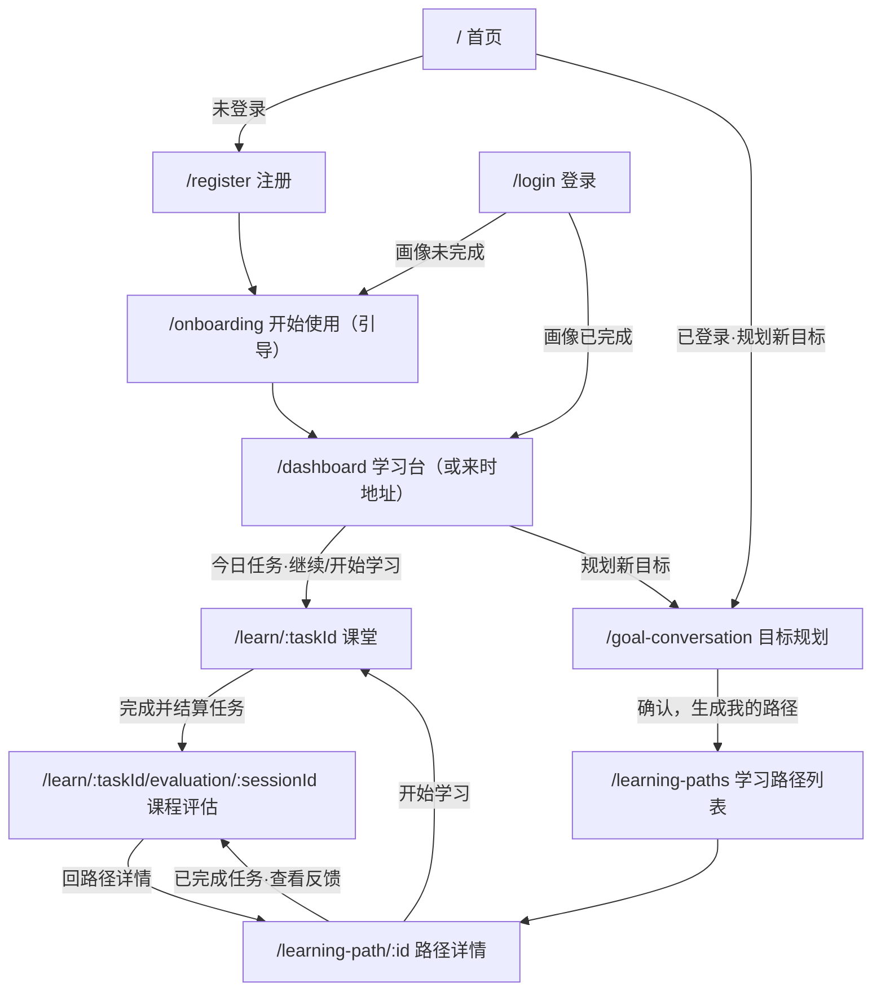
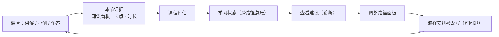

# 用户侧旅程地图（学习者视角）

> 这份文档回答一个问题：**一个学习者从进站到学完一课，路上经过哪些环节、每一步在做什么、页面上能点哪些按钮。**
> 只覆盖学习者侧；运营/管理员侧见 [ADMIN-JOURNEY-MAP-2026-11-01.md](./ADMIN-JOURNEY-MAP-2026-11-01.md)。

- 版本：2026-11-02（2026-11-01 初稿；2026-11-02 按实测审计修订：调整面板按钮文案、评估页真实动作、课堂「暂停并离开」与消息级操作、通知中心、/user 重定向等）
- 事实来源：前端路由表 `frontend/src/router/index.ts`、各页面组件（按钮文案与跳转）、后端接口 `frontend/src/api/*.ts`
- 核实方式：每条「能点的动作」都取自组件里真实存在的按钮/处理函数；每条跳转都取自 `router.push/replace` 的实际目标。不做示意图。

---

## 1. 入口与身份

**关于 `/v2`（这段容易看晕，先说清）**：线上入口一律是非 `/v2` 地址，`/v2/*` **已于 2026-11-01 从路由表移除**（不再有重定向）。

- 曾经是什么：新 UI 上线期间 `/v2/*` 是预览地址；正式上线后页面搬到顶层路径，`/v2/*` 保留为重定向（路由文件里的原话是「`/v2` 已上线：旧地址全部重定向到正式路径」）。
- 现在的状态：那 8 条路由已删除（`/v2`、`/v2/dashboard`、`/v2/goal-conversation`、`/v2/learning-paths`、`/v2/learning-path/:id`、`/v2/learn/:taskId`、`/v2/learning-state`、`/v2/achievements`）。**老书签现在会落到 404 页**。
- 连带清理：巡检脚本 `scripts/v4-ui-audit.mjs` 里靠 `/v2/*` 顺带验证「旧地址也能开」的 3 条已删除（canonical 版本它本来就有）；README 中「旧 `/v2/*` 地址会自动重定向」的说明已删。
- **命名残留**：URL 去掉了前缀，但组件名和目录没改——页面组件仍在 `frontend/src/views/v2/` 下、仍叫 `V2Dashboard` / `V2LearningPage` / `V2GoalConversation` 等。所以在代码里搜 `v2` 到处命中，在浏览器地址栏里却一个都看不到，这是正常的。
- 同类旧地址不止 `/v2`：`/next`、`/next/vision`、`/profile`、`/settings`、`/agent-logs`、`/achievements`、`/learning-history`、`/user`（→ `/user/account`）**仍保留**重定向（书签/外链兼容），这是这个仓库的一贯做法——本次只清理了 `/v2` 那批。
- 迁移时间无法从 git 考证：该文件最早进入历史的那次提交（`d00a057a chore: 累积开发改动`，2026-07-23）里，`/dashboard` 已经指向 `V2Dashboard`、`/v2/dashboard` 已经是重定向——也就是说这次「转正」发生在被记录的历史之前。

| 状态 | 首页主按钮 | 去哪 |
|---|---|---|
| 未登录 | 从一个问题开始 | `/register` |
| 已登录 | 规划新目标 | `/goal-conversation` |
| 已登录（次级） | 回到学习台 | `/dashboard` |

登录后的分叉只看一件事：**画像是否完整**（`onboardingCompleted`）。

---

## 2. 逐站明细（主线 9 站）

| # | 环节 | 路由 | 能点的动作 | 系统在这一步做什么 |
|---|---|---|---|---|
| 1 | 首页 | `/` | 从一个问题开始 ／ 规划新目标 ／ 已有账号，登录 ／ 回到学习台 ／ 看产品怎么走（页内锚点） | 纯导流，自身不留状态；已登录时主按钮跳过注册 |
| 2 | 注册 / 登录 | `/register` · `/login` · `/reset-password` | 注册 ／ 登录（勾「记住我」记住用户名） ／ 找回密码 | 登录后按画像完整度分叉：未完成 → 引导页，已完成 → 学习台或来时地址 |
| 3 | 开始使用（引导） | `/onboarding` | 完成引导 ／ 跳过引导（直接进学习台） ／ 末屏「直接去规划第一个目标 ›」 | 仅首次出现；这一屏建立初始学习者画像，之后的难度、节奏、路径规划都读它 |
| 4 | 学习台 | `/dashboard` | 继续学习 ／ 开始学习（今日任务卡） ／ 规划新目标（含空态「开始规划目标」「先看看路径长什么样」） ／ 顶部导航（目标规划·学习路径·知识图谱·学习状态） ／ 调控提醒「去处理」（→学习状态） ／ 「查看全部路径」 ／ 「全部历史 ›」 ／ 失败/生成中卡「查看详情」「先修改目标」 | 汇总今日任务与整体进度；每天回来的默认落脚点 |
| 5 | 目标规划 | `/goal-conversation` | 快捷选项 ／ **确认，生成我的路径** ／ 回复继续调整 ／ 提交补充，更新方案 ／ 停止 ／ 查看我的路径 | 三步步条：① 澄清问题（顶部显示「已收集 N/7」）→ ② 确认方案 → ③ 生成路径。确认后**在本页生成**（通常几分钟，可离开，进度保留；失败原地重试且已填信息不丢） |
| 6 | 学习路径列表 | `/learning-paths` | 进详情 ／ 重新生成路径 · 重新准备课程（失败时） ／ **删除路径**（二次确认，删后不可自行恢复） | 目标规划确认后新路径落地在这里；生成中的卡片显示真实阶段进度 |
| 7 | 路径详情 | `/learning-path/:id` | 开始学习 ／ 继续当前任务 ／ **调整路径** ／ 回退上次调整 ／ 任务行「微调」 ／ **删除任务**（结构编辑，只允许删尚未开始的任务） ／ 已完成任务「查看反馈」 | 任务状态机在此管解锁与完成；已完成的会话与任务冻结，避免改写已结算口径；页面显示「调整历史」（本条路径出自哪次调整） |
| 8 | 课堂 | `/learn/:taskId` | 发送 ／ 快捷选项 ／ 消息级操作（复制 · 点赞点踩 · 最后一条用户消息内联编辑重发） ／ 重新生成 ／ 停止生成 ／ 重试 ／ 跳过 · 继续（小测） ／ 完成并结算任务 ／ 暂停并离开（进度保留，下次从这继续） ／ 完成浮层的 查看学习反馈 · 延伸学习 · 回到路径详情 | 每轮同一条管线，见第 6 节；结算含自动关课 + 课后产出生成（数十秒，期间有结算进度浮层，快路径下为短窗口展示），未作答的题会先拦住不让结束 |
| 9 | 课程评估 | `/learn/:taskId/evaluation/:sessionId` | 返回学习路径 ／ 继续练习（延伸学习，回课堂追加内容，不结算任务） ／ 完成任务（结算并回路径） ／ 门禁时「回到课堂回答最后 1 个问题」 ／ 薄弱项「去复习」 ／ 降级时「重新生成完整总结」 | 汇总本节证据（知识看板、卡点、时长）并写回学习状态，成为下一次的个性化输入 |

---

## 3. 动作分支：页面上按了这些按钮，会走进哪一套流程

主线之外，有三个按钮会进入独立的处理流程，容易被当成「同一个功能」，实际上口径不同。

### A. 调整路径（微调）— 入口在路径详情主区

三档模式，不是三个按钮，而是同一面板里的三个选项：

| 选项 | 实际含义 | 提交按钮文案 |
|---|---|---|
| 学得不好，想重新来一遍 | 整条重建、从头开始学；已有学习进度时会二次告警，按钮转危险色 | 有进度「确认整条重建」／ 无进度「确认重新规划」 |
| 调整剩余部分 · 保留已学 | 可只调当前阶段，也可从指定阶段起调整到末尾 | 确认调整剩余部分 |
| 让 AI 按学习情况建议 | 提交后先「正在诊断…」，按学习证据给建议 | 让 AI 诊断并建议 |

- **落点不同**：整条重建与 AI 建议落到 replan（重新规划）；调整剩余落到 expand / compress（加内容或压内容），口径定义在 `frontend/src/utils/replanSignal.ts`。
- **可回退**：每次调整前系统自动留存一份调整前安排，所以有「回退上次调整」，且**已学进度不倒退**。
- **任务行级「微调」**：只改单个任务的要求；只对进行中的路径 + 未完成且已解锁的任务开放，已完成任务冻结（避免改写结算口径）。
- **交叉入口**：学习状态页的「查看建议」会带 `?adjust=ai` 直接打开这个面板的 AI 诊断场景——诊断与调整是一条路，不是两件事。

### B. 重新生成路径 / 重新准备课程

两个文案对应**失败位置不同**（`retryType === 'stage_design'` 时叫「重新准备课程」，否则「重新生成路径」），共用一条重试流程。生成期间该路径进不去课堂。

### C. 课堂里的重来与结算

| 动作 | 作用 |
|---|---|
| 重新生成 | 重生成该条导师回复 |
| 停止生成 | 中断正在生成的回答 |
| 重试 | 失败的消息或收尾步骤重来 |
| 跳过 · 继续 | 小测跳过、答错后继续往下走 |
| 完成并结算任务 | 结束本节并生成反馈；有门禁（未作答先拦）；若小测收起后才被拦，横幅会保持并改述「可再次结算」，不会无声消失 |
| 重新生成完整总结 | 评估页动作（课堂页没有此控件）；仅会话已完结且总结/评估降级时出现，可单独重生成 |

结算完成后自动跳反馈页并带倒计时，也可以选「留在此页」或先去「延伸学习」（延伸学习基于已完成的本课追加内容，**不结算任务**）。

---

## 4. 旁路入口（主线之外的常驻页）

| 页面 | 路由 | 用途 |
|---|---|---|
| 学习状态 | `/learning-state` | 跨路径的整体掌握与薄弱点；「查看建议」直达调整面板 |
| 知识图谱 | `/knowledge-map` | 跨路径概念图（课堂里也有图谱，但只画当前路径） |
| 资料库 | `/library` | 学习材料；课堂用到的材料由后端按任务挑选注入 |
| 通知中心 | 顶栏抽屉（无独立路由） | 站内通知；入口挂在顶栏右侧，所有登录后页面常驻 |
| 个人中心 | `/user/account`（`/user` 重定向到此） · `/user/settings` · `/user/achievements` · `/user/learning-history` · `/user/agent-logs` | 资料与密码、设置（含 API 接入分区）、成就、学习历史、调用日志 |
| 愿景 / 开发者文档 | `/vision` · `/docs` | 静态内容 |

---

## 5. 闭环：证据怎么回流

关键点：**学习证据不是只用来展示，它会改写后面的路径**；改写有快照可回退。

---

## 6. 课堂一轮的管线（用户能感知的部分）

1. 导师讲解：真模型调用产出本轮正文。
2. 正文一出来就先上屏（2026-11-01 修复：正文定稿即推送，不再等板书与伴学跑完）——用户先读到老师的话，板书随后到。
3. 是否出小测由**确定性闸门**决定，不由模型自评决定：常规节奏 4 条消息一次，理解度低于 0.6 时加密到 2 条；**本轮不可观测（无证据）时不加速**（2026-11-01 修复）。
4. 小测由**代码判对错**；答错保留待重答（卡片收起，下一回合同一题重挂可再答），同一题最多作答 2 次（含首答，超限换题推进）；可跳过。
5. 学生可见的「发现卡点」只在**有原话证据**时才显示（2026-11-01 修复）。

---

## 7. 关键状态速查

| 对象 | 状态 |
|---|---|
| 路径 | 进行中 / 已暂停 / 已完成 / 已归档（后端口径）；另有「生成中 / 生成失败」两种生成期表现 |
| 任务 | 待解锁 / 进行中 / 已完成 |
| 会话（路径详情里的状态标签） | 进行中 / 已暂停 / 准备中 / 收尾中 / 已超时 |
| 会话收尾 | 未开始 / 处理中 / 已完成 / 失败 / 已跳过（关课、任务完成、复习完成各有独立状态） |

---

## 8. 边界与未覆盖

- 本文只描述**用户可点的动作与真实跳转**，不评估教学效果优劣。
- 移动端/窄屏行为未逐页核实（布局与折叠规则不在本图范围）。
- 虚拟学习者等仿真入口不属于学习者旅程，见管理台那份。
